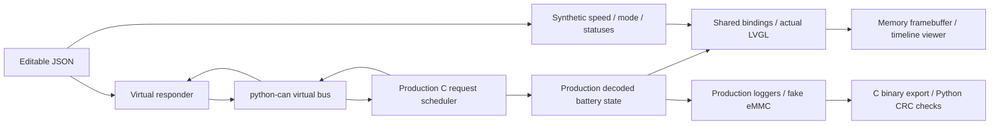

# Remaining work after the MB1381 BDP review

## Implemented result

The repository is in `/Users/youseffarahat/Documents/hard-fs-dashboard`, on `develop`. Editable synthetic timelines now drive the production CAN request scheduler/decoder, actual LVGL screens and production loggers with memory-only peripherals. Speed, N/D/R mode and all seven status indicators are configurable. The original automatic firmware demo remains. See [SYNTHETIC_TESTING.md](SYNTHETIC_TESTING.md) for inputs and commands.

The reproduced partial-flush/indexing defect, Python stream CRC mismatch and storage-percentage overflow are fixed with permanent regressions. The [firmware evidence](BDP_FIRMWARE_EVIDENCE.md) records pre-fix observations; current evidence is in the [storage](SYNTHETIC_STORAGE_EVIDENCE.md), [UI](SYNTHETIC_UI_EVIDENCE.md), [review](SYNTHETIC_REVIEW_EVIDENCE.md) and [integration](SYNTHETIC_INTEGRATION_EVIDENCE.md) reports.

This host path does not execute firmware startup or FreeRTOS tasks. MCU registers, electrical CAN, DMA/cache behavior, actual LCD/touch and physical storage are outside the run. No physical CAN/serial device was accessed. Actual vehicle binding remains unimplemented as requested.

## What the supplied BDP establishes

The supplied `/Users/youseffarahat/Downloads/mb1381-bdp/` contains B04 design evidence with H745XI/H750XB variants. It does not establish the physically connected board revision, fitted parts, jumpers or harness. Exact records, extraction and references are in [BDP_HARDWARE_EVIDENCE.md](BDP_HARDWARE_EVIDENCE.md).

| Area | Verified design/source facts | Required follow-up |
|---|---|---|
| CAN1 | PH13 TX / PH14 RX, U22 MCP2562FD, CN11 pin 1 CANH / pin 2 CANL. STBY has a 10K pull-down; JP7/R224 selectable 120-ohm termination. Firmware pins agree. | Verify actual assembly, jumpers and harness/reference/termination. The design includes a transceiver; it does not establish a need for another one. |
| CAN2 | PB13 TX / PB5 RX, U21, CN10 pin 1 CANH / pin 2 CANL, JP6/R222 termination. | Implement another controller only if the vehicle requires another bus. Application currently uses FDCAN1 only. |
| CAN timing | Classic normal mode, automatic retransmission, HSE selected. Configured 25 MHz divided by `5 × (1 + 8 + 1)` gives 500 kbit/s and 90% sample point. | A configuration calculation, not measured timing or confirmed network compatibility. Obtain network requirements. |
| LCD | CAD Value RK043FN88H-CT661C, 480×272. ST revision history identifies firmware impact for replacement. | Identify fitted panel and authoritative timings; reconcile current 491 active horizontal clocks versus 480 layer width. Old symbol names alone do not establish failure. |
| SDRAM | IS42S32400J; board routes 16 bits, with 8 MiB accessible. Current 16-bit FMC configuration agrees. | Reconcile unused 2 MiB declaration and 32 MiB MPU region with accessible bounds; test aliasing, refresh and timing. No bad access was demonstrated. |
| eMMC | Exact CAD part THGBMTG5D1LBAIL; manufacturer specifies 4 GB. Eight-bit SDMMC routing agrees. ST lists no firmware impact for the swap. | Read actual identity/capacity, confirm reserved region, verify physical reads/writes/export. |
| QSPI | Two 512-Mbit MT25QL512 devices, 128 MiB combined; linker reserves 128 MiB. | Verify fitted topology, JEDEC IDs, mapped readback and loader. Legacy driver name alone does not establish incompatibility. |
| Supply | H750XB variant bridges support selected LDO profile. | Verify actual variant and modified bridges. |

The comparison uses supplied CAD, [ST UM2488](https://www.st.com/resource/en/user_manual/um2488-discovery-kits-with-stm32h745xi-and-stm32h750xb-mcus-stmicroelectronics.pdf), [Microchip MCP2561/2FD](https://ww1.microchip.com/downloads/en/DeviceDoc/20005284A.pdf), [ISSI SDRAM](https://www.issi.com/WW/pdf/42-45S32400J.pdf) and the [Kioxia e-MMC brief](https://www.kioxia.com/content/dam/kioxia/shared/business/memory/mlc-nand/asset/productbrief/KIOXIA_e-MMC_Product_Brief.pdf) to resolve pin/part/capacity questions. No unsupported board configuration change was made.

## Missing code, required information and locations

| Remaining work | What to implement | Where | Required information; source |
|---|---|---|---|
| Battery validity/freshness | Per-signal timestamps/validity; stale transitions without frames; unknown/stale UI; fresh voltage/current pairing. Version logs if metadata changes. | `Inc/app_can.h`, `Src/app_can.c`, `Src/app_dashboard_ui.c`, log/export schemas. | Update rates, maximum age, display/fault policy, statistics windows: system requirements and device manuals. Battery values currently start at zero and retain old samples during pauses. |
| Vehicle input schemas — deferred | Bind speed/mode/status and fault flags to confirmed CAN messages or conditioned GPIO; retain synthetic provider. | `Inc/app_dashboard_ui.h`, future hardware provider, CAN/config/task sources. | Device models/firmware, DBC or full protocol, GPIO meanings/polarities: vendors and vehicle electrical design. Existing `fault_flags` is not decoded by the ten-PID protocol. |
| Runtime CAN policy | Error/bus-off/FIFO-loss diagnostics, recovery/backoff, bounded RX work, delayed/duplicate/unsolicited acceptance and permitted TX policy. | `Src/app_can.c`, `Src/app_can_config.c`, CAN task, `tests/can_host/`. | Load/rate, allowed traffic, response guarantees and recovery rules: network/device specifications. Valid unsolicited PIDs update state; duplicates affect current statistics. |
| Power indicator units | Align quantity, label, sign and scale; energy requires integration/reset policy. | `Src/app_dashboard_ui.c`, `ui/screens/ui_MainScreen.c`. | Requirement choosing A, kW or kWh. Existing caption says `PWR kWh` while its bar receives current magnitude in amps clamped to 1..100. |
| Concurrent storage/export | Bounded storage work/queues, write/drop reporting, coherent RAM dumps while recording, finite export behavior and concurrency tests. | `Src/app_tasks.c`, `Src/app_emmc_log.c`, `Src/app_data_log.c`, `dump_emmc_bin.py`. | Rate, loss/flush limits and reserved-region ownership: system/storage requirements. eMMC export holds a mutex shared with acquisition/UI status; UART timeout is indefinite. Host tests are single-threaded. |
| Persistent recovery | Define resume/new-session policy, header integrity/journaling and interrupted-write recovery. | `Src/app_emmc_log.c`, storage/export tests. | Retention/reboot/power-loss requirements. Initialization starts an empty next session. Padding-hole exports cannot be reconstructed from the export alone. |
| Board profiles/peripheral errors | Fitted panel/memory profiles and bounds; touch initialization/read errors; bench diagnostics. | `Src/main.c`, `Src/Lvgl_Porting/`, selected BSP/configuration and linker. | Actual markings/assembly and component timings: board records, CAD, ST and manufacturer documents. |
| CI verification | Run host decoder, auxiliary, actual UI, storage/export and documentation checks in CI; pin firmware dependencies; add regressions for new policies. | `.github/workflows/`, `tests/`, requirements and CMake. | Acceptance requirements above. Current CI checks formatting. Physical timing/stack/controller/peripheral checks require bench evidence. |

Implementation order: define freshness/display/power requirements; implement them with synthetic regressions; add runtime CAN and storage/concurrency policies; reconcile fitted board peripherals and CI; implement vehicle binding after network/electrical information arrives. Unknown thresholds/encodings are not guessed.

## Implemented synthetic flow

Repository choices are in [VIRTUAL_ENVIRONMENTS.md](VIRTUAL_ENVIRONMENTS.md). [python-can virtual](https://python-can.readthedocs.io/en/v4.6.1/interfaces/virtual.html) provides same-process transport without arbitration/bitrate limits. Host rendering uses checked-in LVGL through a memory display; the external SDL PC port is a reference, not a dependency.

The simulator rejects physical backends. Existing board firmware separately initializes normal transmit-capable CAN and sends requests on `0x7E3`; deferred vehicle binding does not make firmware receive-only. Physical no-damage connection safety is **Insufficient data to verify** from BDP and virtual tests.
