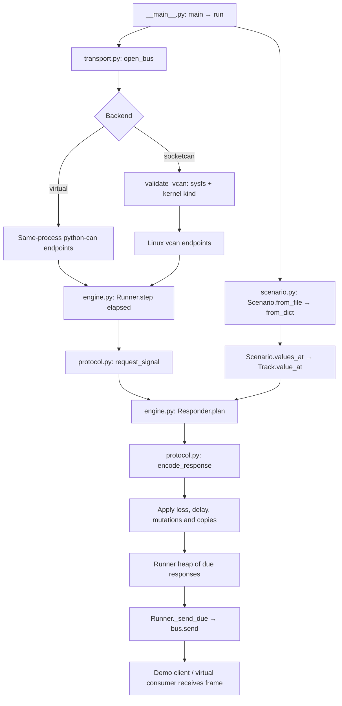

# Editable virtual CAN inputs

This simulator generates the contract implemented in Src/app_can.c. The user confirmed that the physical adapter, BMS and DBC will be supplied later. This implementation uses virtual inputs exclusively and does not implement a connection to a real adapter or BMS. Insufficient data to verify compatibility with the eventual physical bus.

## Run the supplied scenarios

From the repository root, with Python 3.9 or newer:

```sh
python3 -m venv .venv
.venv/bin/python -m pip install -r tools/can_sim/requirements.txt
.venv/bin/python -m tools.can_sim --demo --scenario tools/can_sim/scenarios/normal.json
.venv/bin/python -m tools.can_sim --demo --scenario tools/can_sim/scenarios/edge_cases.json --rate 10
```

On Windows, replace .venv/bin/python with .venv/Scripts/python.exe.

The normal scenario supplies synthetic voltage/current ramps, SOC steps and constant cell/temperature values. The edge-case scenario adds representational boundaries and every supported fault. These are synthetic test data, not a battery specification.

The duration option overrides the scenario stop time. A rate of 10 advances ten simulation seconds per wall-clock second. The default demo request period is 0.05 simulation seconds; the demo cycles through all ten PIDs. The CLI uses a best-effort host clock and skips missed demo periods. It does not reproduce the production C request state machine or guarantee real-time scheduling.

Every transmitted/received frame is logged as one JSON line with simulation time, ID, DLC and exact payload. The final summary reports accepted requests, sent replies and responses queued at stop. To retain the trace:

```sh
.venv/bin/python -m tools.can_sim --demo --scenario tools/can_sim/scenarios/edge_cases.json > can-trace.jsonl
```

The default virtual backend connects endpoints within the **same Python process**. The demo creates both endpoints, so it runs on macOS without CAN hardware. A second process cannot join that channel. The [official python-can virtual documentation](https://python-can.readthedocs.io/en/stable/interfaces/virtual.html) establishes this restriction.

## Change values over time

Edit the JSON and restart the simulator. A constant signal accepts a number; a varying signal accepts points and an interpolation mode:

```json
{
  "version": 1,
  "duration": 8,
  "signals": {
    "pack_voltage_v": 350,
    "pack_current_a": {
      "interpolation": "linear",
      "points": [
        {"t": 0, "value": -100},
        {"t": 4, "value": 0},
        {"t": 8, "value": 100}
      ]
    },
    "pack_soc_pct": {
      "interpolation": "step",
      "points": [
        {"t": 0, "value": 100},
        {"t": 4, "value": 0}
      ]
    }
  },
  "faults": [
    {"start": 2, "end": 3, "type": "delay", "seconds": 0.15},
    {"start": 5, "end": 6, "type": "pause"}
  ]
}
```

Times are simulation seconds. Step interpolation changes at a point's timestamp; linear interpolation ramps between points. Values before/after the points hold the corresponding endpoint. Point times must be nonnegative and strictly increasing. Omitted signals receive synthetic zero. Unknown fields, duplicate JSON keys, unsupported interpolation, nonfinite numbers and out-of-range engineering values are rejected.

## Implemented wire contract

Requests use standard classic-CAN ID 0x7E3 and payload 03 22 PID_H PID_L 00 00 00 00. Responses use ID 0x7EB, service 0x62, a single-frame length byte of 4 or 5, echoed PID, value and zero padding to eight bytes. Multi-frame ISO-TP exchanges are not implemented. This contract is derived from the firmware source; it is not a verified BMS specification.

| Editable signal | PID | Wire value | Accepted engineering input |
|---|---|---|---|
| pack_voltage_v | 0xF00D | unsigned 16-bit, 0.1 V/count | 0–6553.5 V |
| pack_summed_voltage_v | 0xF014 | unsigned 16-bit, 0.01 V/count | 0–655.35 V |
| pack_current_a | 0xF015 | unsigned 16-bit, (raw − 32767) / 10 A | −3276.7–3276.7 A |
| pack_soc_pct | 0xF00F | unsigned byte, 0.5%/count | 0–100% |
| highest_temperature_c | 0xF028 | signed byte, 1°C/count | −128–127°C |
| lowest_temperature_c | 0xF029 | signed byte, 1°C/count | −128–127°C |
| average_temperature_c | 0xF02A | signed byte, 1°C/count | −128–127°C |
| lowest_cell_voltage_v | 0xF032 | unsigned 16-bit, 0.0001 V/count | 0–6.5535 V |
| highest_cell_voltage_v | 0xF033 | unsigned 16-bit, 0.0001 V/count | 0–6.5535 V |
| average_cell_voltage_v | 0xF034 | unsigned 16-bit, 0.0001 V/count | 0–6.5535 V |

These are representation limits, not safe operating limits. Simulator encoding rounds to the nearest count with half counts rounded away from zero. The firmware rounds summed voltage to decivolts, rounds SOC to integer percent and clamps it at 100%, and clamps raw current 65535 to 32767 deciamps. A targeted raw fault exercises those boundaries explicitly.

## Timed fault controls

Every fault requires start, end and type; optional signal restricts it to one signal. Intervals include start and exclude end.

| Type | Parameters and behavior |
|---|---|
| pause | Suppress replies to new requests during the interval. |
| drop | every defaults to 1; drop every Nth request matching this active fault. |
| delay | seconds defaults to 0.2; add delay to each reply. At rate 1, values above 0.1 exceed the firmware timeout. |
| wrong_id | id defaults to "0x123"; replace the standard response ID. |
| wrong_service | service defaults to "0x7F"; replace response byte 1. |
| wrong_pci | pci defaults to "0x25"; replace the length/PCI byte. |
| short_dlc | dlc defaults to 3, range 0–7; truncate actual payload. |
| unknown_pid | pid defaults to "0xFFFF"; must be absent from the firmware table. |
| duplicate | count defaults to 1 extra copy; spacing defaults to 0 seconds. |
| burst | count defaults to 32 total copies, range 1–1024. |
| raw | Requires signal; value replaces its raw payload with an unsigned integer fitting its width. |

Matching delays and copy additions add together; the largest duplicate spacing applies to all copies. Header mutations precede truncation. For overlapping field replacements, the last matching fault wins; the shortest requested DLC applies. Pause/drop suppress a newly planned reply. Pause does not cancel already queued delayed replies. Values are sampled when the request arrives.

Virtual receive queues hold 1024 frames. The response scheduler defaults to 4096 pending frames; exceeding capacity stops with an explicit error. Queue/send failures are not silently discarded.

## Linux virtual bus across processes

Linux vcan supports separate local processes without a real controller, as documented by the [Linux kernel](https://www.kernel.org/doc/html/latest/networking/can.html#the-virtual-can-driver-vcan) and [python-can SocketCAN setup](https://python-can.readthedocs.io/en/stable/interfaces/socketcan.html#the-virtual-can-driver-vcan).

On Linux with iproute2 and the vcan kernel module:

```sh
sudo modprobe vcan
sudo ip link add dev vcan0 type vcan
sudo ip link set vcan0 up
.venv/bin/python -m tools.can_sim --interface socketcan --channel vcan0 --scenario tools/can_sim/scenarios/normal.json
```

In separate terminals, with can-utils installed:

```sh
candump vcan0
cansend vcan0 7E3#0322F00D00000000
```

The simulator requires a vcan name followed by digits, sysfs pointing to a virtual CAN device of type 280, no hardware device entry, and kernel link kind exactly vcan from ip -details -json link show. A renamed physical adapter and vxcan are rejected. The bus uses ignore_config=True to isolate external CAN configuration. [Linux defines CAN type 280](https://github.com/torvalds/linux/blob/master/include/uapi/linux/if_arp.h); [python-can documents configuration isolation](https://python-can.readthedocs.io/en/stable/bus.html#can.Bus).

These Linux commands have not been run on this macOS host. Sysfs/link-kind fixtures verify the guard; actual Linux SocketCAN traffic remains unverified here.

## Function flow and embedding



For deterministic tests, pass time directly to Runner.step; no sleep is required:

```python
from tools.can_sim.engine import Responder, Runner
from tools.can_sim.protocol import make_request
from tools.can_sim.scenario import Scenario
from tools.can_sim.transport import open_bus

scenario = Scenario.from_dict({"signals": {"pack_current_a": -12.3}})
with open_bus("virtual", "example") as server, open_bus("virtual", "example") as client:
    runner = Runner(server, Responder(scenario))
    client.send(make_request("pack_current_a"))
    runner.step(0.0)
    frame = client.recv(timeout=0.1)
    assert frame.data.hex() == "0562f0157f840000"
```

Run the simulator suite:

```sh
.venv/bin/python -m unittest discover -s tests -p 'test_can_sim*.py' -v
```

It covers ten PID encodings, boundaries, invalid requests, JSON validation, step/linear trajectories, faults, queue capacity, clock reversal, actual python-can virtual exchange, the CLI and physical-interface rejection. Production C behavior is exercised separately under tests/can_host; the virtual demo alone does not prove the production decoder.
