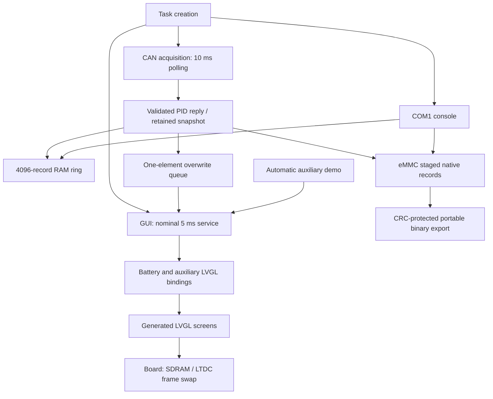

# Firmware code explained

This guide covers the eight maintained application/board-port source files and their eight public headers. Each function now has a contract beside its implementation describing the inputs and units, output, state changes, ordering and failure behavior established by the body. The function-by-function section below links to those implementations. Comments explain current behavior; they do not introduce vehicle encodings or change executable code.

## How data moves

`main` calls [app_tasks_start](../Src/app_tasks.c) before starting FreeRTOS. Task creation initializes both loggers and a one-element queue, then creates GUI, CAN acquisition and UART console tasks. The CAN task initializes the controller and polls every 10 ms; accepted responses produce a complete retained battery snapshot. It records that snapshot in RAM and eMMC, then overwrites the queue. Several responses drained during one poll become one recorded/latest UI snapshot. This is acquisition-triggered logging, not one row on every fixed UI tick.

The GUI task initializes LVGL, the board display, touch and generated screens in that order. It applies initial zero battery data, runs the existing auxiliary demo, drains latest battery updates and services LVGL every nominal 5 ms. All normal LVGL object mutations happen here. Queue overwrite keeps the latest state but can omit intermediate states when acquisition is faster than display consumption. eMMC append and queue results are ignored by acquisition; a visible update does not prove a successful persistent write.

The console receives one COM1 byte with a 50 ms HAL timeout and dispatches its character. It can inspect/reset RAM history, inspect/flush/reset/export eMMC, and toggle CAN diagnostics. CSV and binary exports are synchronous. eMMC export holds its logger mutex while printing/transmitting, so append and status operations can wait. Temporarily disabling CAN diagnostics does not implement exclusive UART ownership for all writers.

The host simulator reuses the CAN, bindings and logger implementations with virtual transport and memory peripherals. It does **not** run these FreeRTOS tasks, this LCD/touch port or MCU initialization. Its actual LVGL pixel captures establish synthetic rendering behavior, not electrical or fitted-panel operation.

## CAN state and integer units

[app_can.h](../Inc/app_can.h) defines the retained snapshot copied to queue, UI and logs. Pack voltage and summed pack voltage are unsigned counts of 0.1 V; cell voltage is unsigned counts of 100 microvolts. Current and its statistics are signed counts of 0.1 A. Power statistics are signed whole kW; SOC is integer percent and temperature is signed whole Celsius. `fault_flags` is present but the ten-PID decoder does not set it. Battery fields have no per-field validity or age, start at zero and retain the last accepted values during missing responses.

[app_can_config.c](../Src/app_can_config.c) returns immutable FDCAN1/PH14 RX/PH13 TX/AF9/classic configuration. [app_can.c](../Src/app_can.c) selects HSE, normal mode and automatic retransmission. With the configured 25 MHz HSE, `25,000,000 / (5 × (1 + 8 + 1))` calculates 500 kbit/s; this is a configuration calculation, not measured network timing. One exact standard-ID filter sends `0x7EB` replies to an eight-element RX FIFO; unmatched/remote traffic is rejected. TX has one eight-byte slot.

The request table fixes this round-robin contract:

| PID | Measurement | Raw response conversion | Expected PCI byte |
|---|---|---|---|
| `F00D` | Pack voltage | Big-endian uint16, already decivolts | 5 |
| `F014` | Summed pack voltage | `(raw + 5) / 10` into decivolts | 5 |
| `F015` | Pack current | `raw - 32767`, clipped to int16 deciamps | 5 |
| `F00F` | SOC | `(raw_byte + 1) / 2`, clipped to 100 percent | 4 |
| `F028`, `F029`, `F02A` | Highest, lowest, average temperature | Byte cast to signed int8 Celsius | 4 |
| `F032`, `F033`, `F034` | Lowest, highest, average cell voltage | Big-endian uint16 in 100-microvolt counts | 5 |

Requests are standard classic eight-byte frames on `0x7E3`: `[03,22,PID-high,PID-low,00,00,00,00]`. Decoder acceptance requires standard classic data-frame ID `0x7EB`, exactly eight payload bytes, service `0x62`, a known PID and its exact PCI byte. There is no multi-frame ISO-TP reassembly. These are the implemented software encodings; the future vehicle/BMS contract remains unverified and deferred.

Polling captures HAL milliseconds once, expires pending requests only at an unsigned elapsed age **greater than** 100 ms, drains RX until empty or a HAL read failure, then sends the next PID if idle and elapsed time is at least 50 ms. Unsigned subtraction supports tick rollover. A matching pending PID clears/advances the scheduler; valid unsolicited/duplicate replies also update measurements, and duplicate currents also contribute statistics. A successful HAL enqueue does not prove physical delivery.

Current statistics keep private minimum, maximum, signed 64-bit sum and uint32 sample count since static initialization. Mean rounding adjusts by half the count before signed division. Power statistics are collected only on current replies, using retained nonzero pack voltage or summed voltage; the pair has no freshness check. Each power sample is rounded to integer kW before accumulation: `current_deciamps × voltage_decivolts / 100000`. There is no time integration, sliding window, reset API or sample-count overflow policy.

## UI binding and auxiliary model

[app_dashboard_ui.h](../Inc/app_dashboard_ui.h) separates auxiliary inputs from battery fields. Speed is integer km/h with a validity boolean; drive mode is internal N/D/R with its own validity. Seven status entries each carry `valid` and `fault_active`; enum order maps to IMD, Fault, RTD, TSAL, BSPD, SDC and Ready to Drive. These names do not establish physical GPIO polarity or CAN bits.

[app_dashboard_ui.c](../Src/app_dashboard_ui.c) applies valid speed/mode as text and unknown values as dashes. For the first 3000 ms, or while status initialization is false, the whole status group is visible. Afterward, **any** unknown/faulted status keeps **all seven** visible; all seven known healthy hides the whole group. Each indicator independently uses gray for unknown, red for valid fault and green for valid healthy.

The preserved automatic demo increments speed by 3 once per qualifying 200 ms call, reverses at 0 and 160, and cycles N/D/R every 5000 ms. Missed intervals do not replay increments. Its private static timing/speed state persists across calls and has no reset API; all seven statuses are marked valid/healthy. Host scenarios bypass the demo and apply explicit state instead.

Battery labels show signed Celsius, rounded cell millivolts and signed whole-kW power statistics. The temperature slider clamps to 1..100. The existing consumption slider receives rounded current magnitude in amps, also clamped to 1..100, while its generated caption says `PWR kWh`; quantity/units policy remains unresolved. SOC supplies the percentage bar. Debug labels show rounded RAM and eMMC occupancy using 64-bit multiplication; eMMC capacity excludes the metadata header and avoids double-counting an already-written tail. Usage is allocation percentage, not a durability or health diagnosis.

## RAM records, eMMC blocks and wire export

[app_data_log.c](../Src/app_data_log.c) owns 4096 timestamped full snapshots. `head` is next physical write position; `count` saturates at capacity. Before filling, oldest is slot zero; when full, oldest is `head`. The first overwrite after saturation sets a sticky `wrapped` flag. Critical sections cover individual operations, including copy-by-value reads, but an entire CSV export is not a coherent frozen transaction because rows are copied separately.

[app_emmc_log.c](../Src/app_emmc_log.c) uses BSP instance zero, 512-byte blocks, start block 4096 (2 MiB) and a requested 262144-block reservation (128 MiB) limited against reported card capacity. One reserved block stores a 512-byte session header; following blocks hold native timestamp/snapshot/CRC records. Native padding participates in storage CRC, so the record is zero-initialized before copying fields. This region is raw storage; no filesystem reservation mechanism is implemented.

The mutex-owned state distinguishes buffer bytes, an already-written partial tail, dirty data and dirty metadata. A first partial flush allocates/counts one data block but retains its contents in RAM. Later appends fill remaining record slots and a subsequent flush rewrites that same physical tail. When another record cannot fit, release the tail and start another block. The trailing block padding is `0xFF`; export maps logical records using `512 / sizeof(native_record)` so padding is not read as samples. Data-write failure retains dirty state; a successful data write followed by header failure leaves metadata available for retry.

Accepted append increments logical count immediately and can still be staged only in RAM. A later flush failure can return false after staging/count mutation. Full-region overflow returns false after setting overflow metadata. The status `staged_bytes` excludes a retained already-written tail, including newly dirty bytes in that allocated tail; therefore it is not an exact unpersisted-byte counter.

Initialization reads an old header only for recognized magic/version and next session ID. It starts a new empty session, does not resume records, does not erase all old data blocks and implements no header CRC/journal or interrupted-write recovery. Reset similarly discards staged data and logical history and writes a new header. Those semantics must be chosen against retention/power-loss requirements before physical use.

Binary export explicitly emits a 24-byte `HFDB` header, 42-byte portable little-endian rows and 16-byte `HFDE` footer. Each row contains timestamp, scaled battery fields, stored native-CRC validity flag, stored native CRC and a portable row CRC; signed fields preserve their bit pattern. Header CRC covers 20 preceding bytes, row CRC covers 38, stream CRC covers all complete portable rows, footer CRC covers 12. CRC uses reflected `0xEDB88320`, seed/all-one and final XOR; the updater itself is raw/unfinalized. Invalid native CRC is reported, not repaired or used to abort export. Storage/UART errors can yield an incomplete stream, which the receiver must reject using counts/footer/checksums.

## Board ports and supplied BDP

The board comparison comes from [BDP_HARDWARE_EVIDENCE](BDP_HARDWARE_EVIDENCE.md) and [BDP_GAP_ANALYSIS](BDP_GAP_ANALYSIS.md), which identify the supplied MB1381 B04 CAD and the exact manufacturer/ST references. It establishes design agreement, not which revision/parts/jumpers are physically connected.

CAN1 PH13 TX/PH14 RX agrees with CAD routing to U22 MCP2562FD and CN11; the design includes a transceiver and selectable termination. The MCU-ball labels were checked directly against extracted `STM32_microcontroller_IOs` CAD records 4329/4331: PH14/B17 RX and PH13/D16 TX. The existing comment and executable GPIO selection agree and remain unchanged. CAD does not provide future vehicle IDs, scaling, periods or a harness contract.

[lvgl_port_lcd.c](../Src/Lvgl_Porting/lvgl_port_lcd.c) initializes SDRAM, panel-control GPIO, PLL3/LTDC pins and a single opaque RGB565 layer; it clears and registers two full-screen BSP-addressed framebuffers. Flush cleans/invalidates the full data cache, switches the LTDC layer address and immediately acknowledges LVGL. There is no explicit vertical-blank wait here. Duplicate init or checked critical HAL/BSP/display failures enter `Error_Handler`. The 480×272 layer agrees with CAD panel geometry; the retained HBP-minus-11 adjustment calculates 491 active horizontal clocks and needs exact fitted-panel timing evidence before any change. Host pixels do not validate that timing or cache behavior.

The BDP routes 16-bit SDRAM with 8 MiB accessible, agreeing with selected BSP width; differing unused size declaration and MPU bounds remain in the gap report. Eight-bit SDMMC routing agrees with the selected eMMC BSP; actual identity/capacity/reserved-region ownership still need bench evidence. QSPI topology/programming and supply bridge population are startup/BSP concerns outside these owned application files.

[lvgl_port_touchpad.c](../Src/Lvgl_Porting/lvgl_port_touchpad.c) registers BSP instance-zero pointer input using LCD dimensions and XY swap. Press events copy detected pixel coordinates; release events keep the last pair. Initialization failures return silently, read status is ignored, and registration result is not checked. These omissions are documented current behavior, not repaired in a comment expansion.

Insufficient data to verify physical panel/touch/storage/CAN operation, vehicle protocol compatibility or no-damage electrical connection. Synthetic working behavior and BDP design agreement have separate evidence and scope.

## Function-by-function contracts

### Src/Lvgl_Porting/lvgl_port_lcd.c

**[lcd_error](../Src/Lvgl_Porting/lvgl_port_lcd.c:33)** — Enter the application Error_Handler, which disables interrupts and loops indefinitely. No arguments or return result; centralize the fatal path for display setup and address- switch failures. Error_Handler has no recovery path in this application, so callers do not receive an error status.

**[lcd_panel_prepare](../Src/Lvgl_Porting/lvgl_port_lcd.c:45)** — Enable the LCD control GPIO clocks and configure output pins; hold backlight, display enable and reset low and select the display mode. Use board BSP GPIO macros, output push-pull/no-pull/low-speed, before applying the initial control levels. Assumes display-enable and backlight pins share the port used for their combined initialization. No GPIO HAL return status is checked.

**[lcd_panel_power_on](../Src/Lvgl_Porting/lvgl_port_lcd.c:78)** — Assert LCD display enable, wait 20 ms, release reset and wait 120 ms using HAL delays. This ordered sequence controls the configured enable/reset pins, not the backlight. Delays are blocking HAL millisecond waits; their compatibility with the fitted panel remains a board-profile verification item.

**[lcd_backlight_on](../Src/Lvgl_Porting/lvgl_port_lcd.c:93)** — Assert the LCD backlight GPIO after display setup. Drive the configured backlight control pin high after registration and cleared framebuffer setup. There is no brightness/PWM setting, failure return or later automatic shutdown.

**[lcd_ltdc_msp_init](../Src/Lvgl_Porting/lvgl_port_lcd.c:107)** — Configure PLL3 for LTDC, enable LTDC/GPIO clocks, select the display alternate-function pins and reset LTDC; enter the error handler if the peripheral-clock configuration fails. No arguments; configure PLL3 M=5,N=160,R=83 and LTDC source, then AF14 RGB/control pins on K/I/J/H. HAL peripheral-clock failure enters the fatal path, while GPIO operations have no checked result. Reset/release LTDC after pin configuration; no fitted-panel identity is read.

**[lcd_ltdc_init](../Src/Lvgl_Porting/lvgl_port_lcd.c:163)** — Initialize LTDC timing and its RGB565 layer at the first framebuffer address; enter the error handler on HAL initialization or layer configuration failure. Use BSP RK043FN48H constants, active-low sync/DE and input pixel-clock polarity; configure one opaque RGB565 layer at LCD_LAYER_0_ADDRESS sized LCD_DEFAULT_WIDTH by LCD_DEFAULT_HEIGHT. The horizontal HBP-minus-11 adjustment is retained: active timing calculates 491 clocks while the image layer is 480 pixels. This requires exact-panel evidence before alteration and is not exercised by host rendering.

**[disp_flush](../Src/Lvgl_Porting/lvgl_port_lcd.c:221)** — LVGL flush callback: ignore area, clean/invalidate the data cache, point LTDC layer zero at color_p and signal completion through drv; enter the error handler if changing the address fails. LVGL supplies drv and the full-frame draw buffer color_p. Because full_refresh is enabled, area is intentionally unused and no pixel copy is made: flush all data cache then switch the LTDC layer base. Signal lv_disp_flush_ready immediately after HAL success; no explicit vertical-blank synchronization or controller-completion wait is present here.

**[LCD_init](../Src/Lvgl_Porting/lvgl_port_lcd.c:244)** — Initialize SDRAM, LCD panel and LTDC, clear two full-screen framebuffers and register a full-refresh LVGL display before enabling backlight; duplicate initialization or failed hardware/display setup enters the error handler. Must follow lv_init and precede ui_init. Initialize BSP SDRAM instance zero, prepare controls/clocks/reset/timing, then zero two width*height buffers, maintain cache and register both as a full-screen LVGL draw buffer. display is a persistent registration pointer; a second call is fatal. Backlight is enabled only after nonnull registration. The host simulator uses a different memory display and does not run this routine.

### Src/Lvgl_Porting/lvgl_port_touchpad.c

**[touchpad_read](../Src/Lvgl_Porting/lvgl_port_touchpad.c:32)** — LVGL pointer callback: ignore drv, read the BSP touch state and fill data with pressed coordinates or the last position with released state; BSP read status is not checked. LVGL supplies writable data; no null guard is present. TouchX/TouchY are pixel coordinates after BSP orientation; save the last detected pair and reuse it on release so release events keep a position. Ignoring BSP_TS_GetState failure means the existing ts_state may be used after a failed read; no error/unknown event is synthesized.

**[touchpad_init](../Src/Lvgl_Porting/lvgl_port_touchpad.c:61)** — Initialize the BSP touch controller for LCD dimensions with XY swap and register an LVGL pointer read callback; return immediately if BSP initialization fails. No arguments or return status; select BSP instance zero, LCD pixel dimensions, TS_SWAP_XY and accuracy 5. BSP init failure silently leaves touch unregistered. Otherwise initialize the persistent LVGL driver and store the registration pointer without checking for null; repeated calls have no duplicate-registration guard.

### Src/app_can.c

**[app_can_log_init_failure](../Src/app_can.c:147)** — Report the failing initialization stage when debug output is enabled and return false. stage names the failed setup operation. The return is always false so initialization callers can propagate failure directly; printing also reads the handle error code. It does not reset hardware or clear previously decoded data.

**[app_can_abs_int32](../Src/app_can.c:165)** — Return an absolute value for the signed int16-range values passed by the debug formatter. The result is a signed 32-bit magnitude used only for decimal formatting. Callers widen int16_t first, including -32768; the helper itself does not guard a general INT32_MIN input and has no state changes.

**[app_can_clamp_int64_to_int16](../Src/app_can.c:176)** — Saturate a wide signed result to the dashboard signed 16-bit storage range. Accept a signed 64-bit arithmetic result and return INT16_MIN/INT16_MAX at the limits, otherwise cast exactly. This bounds stored current means and power values without changing any accumulator.

**[app_can_print_unsigned_deci_volts](../Src/app_can.c:195)** — Print a labeled decivolt value with one decimal digit; ignore a null label. One input count means 0.1 V. Integer quotient and remainder produce a decimal V suffix without floating point; output has a leading space and no trailing newline. The snapshot is unchanged.

**[app_can_print_unsigned_100uv_volts](../Src/app_can.c:210)** — Print a labeled cell-voltage value in 100-microvolt units with four decimal digits. One input count means 0.0001 V. Divide by 10000 and zero-pad the remainder to four digits; a null label produces no output. This is formatting only and does not validate the measured range.

**[app_can_print_signed_deci_amps](../Src/app_can.c:228)** — Print signed deciamps as a labeled amperage with one decimal digit. One input count means 0.1 A. Widen before taking magnitude, preserve the sign separately, and print whole/fractional parts with A; null label returns before output. No statistics or sample fields change.

**[app_can_get_display_voltage_deci_volts](../Src/app_can.c:250)** — Prefer nonzero pack voltage, otherwise summed pack voltage; return zero for null data. The pointer is a retained CAN snapshot; return units remain 0.1 V. Zero is treated as a fallback trigger rather than as validity metadata. Neither source has an age check, and this function writes no state.

**[app_can_compute_power_kw](../Src/app_can.c:269)** — Convert deciamps times decivolts to integer kW, rounding half values away from zero. Both inputs are integer-scaled samples: current in 0.1 A and voltage in 0.1 V. A 64-bit product avoids intermediate overflow; division by 100000 converts to kW and the returned int16_t saturates if needed. This computes instantaneous power, not integrated energy.

**[app_can_print_signed_integer](../Src/app_can.c:289)** — Print a labeled signed integer when a label is supplied. value is printed in signed decimal without a units suffix or newline. The debug caller supplies the meaning through label; null label is a no-op and all measurement/statistics state remains unchanged.

**[app_can_debug_log_request](../Src/app_can.c:304)** — Log a PID submitted for transmission only when CAN debug output is enabled. pid is the 16-bit identifier just accepted by the HAL TX queue, printed in hexadecimal. This message does not establish delivery or a CAN acknowledgement; no pending-request fields are changed here.

**[app_can_debug_log_timeout](../Src/app_can.c:318)** — Log an outstanding PID that exceeded its timeout when CAN debug output is enabled. pid is the scheduler identifier whose elapsed request age exceeded the configured timeout. This helper only emits text; the polling caller clears pending state and advances the sequence.

**[app_can_debug_log_response](../Src/app_can.c:334)** — Log a validated eight-byte reply and its decoded measurement/statistics when debug is enabled. rx_data must address eight already-validated bytes and data must point to the post- decode snapshot. Select the matching PID field, add current/power statistics for current replies, and print fault_flags. Null pointers or disabled debugging produce no output; neither input is mutated.

**[app_can_enable_gpio_clock](../Src/app_can.c:417)** — Enable one supported GPIO A-I peripheral clock, returning false for another port. port is a HAL GPIO register pointer. The A through I pointer comparisons select exactly one RCC clock-enable macro; success means a supported port was selected, not a pin or transceiver test. No HAL error result is available from these macros.

**[app_can_set_debug_enabled](../Src/app_can.c:465)** — Enable or disable CAN initialization, request, response and timeout serial diagnostics. enabled replaces the module-wide boolean consulted by initialization, TX, RX and timeout printers. It has no return value and does not stop CAN requests or protect against concurrent console output.

**[app_can_is_debug_enabled](../Src/app_can.c:475)** — Return the current CAN diagnostic-output setting. Return the module-wide debug boolean without side effects. DEBUG builds start with true, other builds false; later calls to the setter override that default.

**[app_can_config_is_supported](../Src/app_can.c:486)** — Accept only a nonnull configuration selecting the implemented classic CAN mode. Only mode is examined after the null guard: APP_CAN_MODE_FD is declared in the interface but not implemented here. Instance validity, pins and electrical compatibility are not checked by this predicate.

**[app_can_clamp_percentage](../Src/app_can.c:501)** — Limit a decoded unsigned state-of-charge percentage to 100. value is an unsigned integer percent after the SOC decoder conversion. Values 0 through 100 pass through; larger values return 100. It neither reports invalid raw data nor attaches a validity flag.

**[app_can_decode_orion_current_deci_amps](../Src/app_can.c:517)** — Subtract the implemented 32767 raw-current offset and saturate to signed deciamps. The existing protocol interprets the big-endian raw 16-bit word as an offset-binary number with zero at 32767. Return units are 0.1 A; raw 65535 would produce 32768 and is therefore clipped to 32767. This is the implemented encoding, not confirmation of a future BMS protocol.

**[app_can_update_current_stats](../Src/app_can.c:539)** — Accumulate accepted current samples into signed min/max and nearest-integer mean values. data must contain the newly decoded current in 0.1 A. The first sample seeds persistent min/max/sum/count; subsequent samples update them and write rounded signed mean/min/max back into the snapshot. Every accepted current reply counts, including duplicates; there is no time window, session reset or count-overflow handling in this helper.

**[app_can_update_power_stats](../Src/app_can.c:587)** — Accumulate integer-kW min/max/mean at current-sample time when pack voltage is nonzero. Use retained nonzero pack voltage, or summed voltage, with the newly decoded current. Round each power sample to integer kW before maintaining persistent min/max/sum/count and writing the rounded mean. Null data or zero selected voltage leave statistics unchanged. Sampling has no freshness pairing or time integration.

**[app_can_get_next_request_pid](../Src/app_can.c:643)** — Return the PID at the current position in the ten-request round-robin table. The private index must remain in the request-table range. Return the table PID without advancing it or changing pending state; initialization and the advance helper establish that invariant.

**[app_can_advance_request_sequence](../Src/app_can.c:654)** — Advance the ten-request round-robin position and wrap from the final PID to the first. Increment the private request enum modulo APP_CAN_REQUEST_COUNT. The polling caller invokes this only on timeout or a reply matching the pending PID; sending a request does not advance it.

**[app_can_dlc_to_bytes](../Src/app_can.c:666)** — Translate a HAL DLC constant to its payload-byte count; unknown constants map to zero. data_length_code uses HAL-encoded DLC constants, not a byte count. Mapping includes legal FD lengths up to 64 so the receiver can reject them after HAL has copied into the 64-byte scratch buffer. This conversion does not itself accept a frame.

**[app_can_send_pid_request](../Src/app_can.c:714)** — Submit one padded classic eight-byte service-0x22 request when initialized and TX space exists. pid becomes big-endian bytes 2 and 3 after PCI 0x03 and service 0x22; remaining bytes are zero padding. TX uses standard ID 0x7E3, eight-byte classic data format and no BRS. Return false before enqueue if uninitialized or FIFO full, or after a HAL enqueue failure. Success only enqueues; polling records pending PID/time afterward.

**[app_can_response_length_is_valid](../Src/app_can.c:752)** — Accept only the table's exact ISO-TP single-frame length; larger PCI values include other frame types. pid selects a table entry and pci_length is the complete first payload byte. Equality with 4 or 5 enforces the implemented single-frame form and excludes multi-frame PCI values. Unknown PID returns false; no data or scheduler state changes.

**[app_can_decode_orion_response](../Src/app_can.c:774)** — Validate standard classic data-frame metadata and exact single-frame length, then decode a known PID. Require nonnull pointers, standard classic data ID 0x7EB, exactly eight payload bytes, service 0x62 and the known PID-specific PCI. Reconstruct 16-bit values big-endian; summed voltage rounds raw hundredths of volts into decivolts, current subtracts 32767, SOC halves/rounds/clamps, temperatures cast to signed Celsius, and cell values retain 100-microvolt units. A valid current reply also mutates module statistics. Other failures return false without updating the supplied snapshot. Matching a pending request is not required; fault_flags is not decoded.

**[app_can_handle_rx_message](../Src/app_can.c:863)** — Publish a successfully validated reply to the latest dashboard snapshot and optionally log it. Start from a copy of the retained snapshot so fields outside this PID survive. A successful decoder call publishes the whole updated copy and prints it; false leaves the retained snapshot untouched. It does not compare the reply PID to pending state; polling performs that separate sequence operation.

**[app_can_init](../Src/app_can.c:889)** — Initialize FDCAN using the board configuration and response-ID filter; report failures for caller retry. With no arguments, return true immediately if already initialized. Select HSE, normal classic mode and automatic retransmission; allocate one exact-ID standard filter, eight RX FIFO0 slots and one TX FIFO slot. Clock/init/filter/start failures return false for task retry. Only full success marks ready and resets request position/pending/time; existing measurement/statistics storage is not cleared. At the configured 25 MHz HSE, prescaler 5 with 1+8+1 time quanta calculates 500 kbit/s.

**[app_can_poll_dashboard_data](../Src/app_can.c:993)** — Expire overdue requests, drain valid replies, and send the next PID every 50 ms when idle. Copy the latest snapshot only after a valid reply; unsigned elapsed-time arithmetic supports tick rollover. data is caller storage for a full snapshot and is written only if at least one reply is accepted. Capture HAL milliseconds once; expire pending requests only when unsigned elapsed time is strictly greater than 100 ms, then drain FIFO0 until empty or HAL read failure. Valid unsolicited/duplicate replies still update measurements, while only a matching PID clears pending and advances. When idle and elapsed time is at least 50 ms, enqueue the next request and record its time on success. Return false for null/uninitialized input or no accepted reply; no battery-staleness transition is produced.

**[HAL_FDCAN_MspInit](../Src/app_can.c:1053)** — Configure clocks and RX/TX alternate-function pins only for the configured FDCAN instance. The HAL callback handle must match the immutable configured instance. Unsupported/null inputs return silently; supported port clocks are enabled before AF push-pull, no-pull, very-high-speed RX and TX pins are configured independently. FDCAN1 additionally enables its RCC clock. This function does not configure bus timing or test physical routing.

**[HAL_FDCAN_MspDeInit](../Src/app_can.c:1091)** — Release RX/TX pins and the FDCAN1 clock only when the handle matches the board configuration. For a matching nonnull handle/configuration, deinitialize both configured GPIO pins, then disable the clock for FDCAN1. Other handles return without changes. It does not clear app_can_initialized or retained measurements and is a HAL resource callback, not the application shutdown API.

### Src/app_can_config.c

**[app_can_config_get](../Src/app_can_config.c:38)** — Return the immutable FDCAN instance, pins and classic-CAN mode used by the application. The returned pointer references static const storage with program lifetime: FDCAN1, GPIOH RX14/TX13, AF9, classic mode. Callers must not modify it; there is no allocation, runtime configuration or failure branch.

### Src/app_dashboard_ui.c

**[app_ui_abs_int32](../Src/app_dashboard_ui.c:30)** — Return the magnitude of value for current-to-display conversion; the callers pass int16_t current values, so INT32_MIN is outside their input range. Return a signed 32-bit magnitude with no state changes. Widening int16_t before the call preserves its most-negative value; no generic INT32_MIN guard exists.

**[app_ui_slider_from_temperature](../Src/app_dashboard_ui.c:42)** — Convert signed Celsius to the UI slider range 1 through 100 by clamping; return the display value without changing the sample. Input units are signed whole degrees Celsius. Negative, zero and very cold samples all display at the minimum, and samples above 100 display at the maximum; this display clamp does not diagnose temperature faults.

**[app_ui_slider_from_current](../Src/app_dashboard_ui.c:63)** — Round the magnitude of current in deciamps to whole amps and clamp it to the UI slider range 1 through 100; return the display value. Input units are signed 0.1 A; add five before division by ten to round magnitude. The returned bar value loses sign, clips above 100 A and displays even zero at 1. The generated screen caption currently says PWR kWh, so this binding has an unresolved units requirement.

**[app_ui_set_voltage_mv_label](../Src/app_dashboard_ui.c:85)** — If label exists, convert voltage from 100-microvolt units to rounded millivolts and replace its LVGL text; null labels are ignored. Input units are 100 microvolts per count; adding five before division by ten rounds to millivolts. The decimal label contains no units suffix. Only the LVGL object text changes; the integer sample is preserved.

**[app_ui_set_signed_integer_label](../Src/app_dashboard_ui.c:103)** — Replace an existing LVGL label with the signed decimal value; ignore a null label. The caller determines units (currently integer kW statistics); this helper formats signed base-ten text and has no range conversion. Only an existing object is touched and null is a no-op.

**[app_ui_calculate_usage_percent](../Src/app_dashboard_ui.c:119)** — Return used/total as a rounded integer percentage, or zero for zero capacity; the 64-bit intermediate arithmetic prevents multiplication overflow. used and total must use the same units (records or bytes). Add half of total for nearest-integer rounding before division; return is not clamped at 100 if used exceeds total. The helper does not read logger state itself.

**[app_ui_get_status_panel](../Src/app_dashboard_ui.c:135)** — Return the LVGL panel pointer mapped to signal_id, or NULL for the count sentinel or an unknown signal; do not create objects. The seven switch arms preserve the generated screen variable names, including ui_panleReadyToDrive. The returned object is borrowed from ui_init and must not be freed here; the mapping has no side effects.

**[app_ui_get_status_label](../Src/app_dashboard_ui.c:165)** — Return the LVGL label pointer mapped to signal_id, or NULL for the count sentinel or an unknown signal; do not create objects. Use the same enum order as status_signals and map each entry to its generated LVGL label. Objects are borrowed and may still be null before screen creation; invalid enum values return null.

**[app_ui_set_object_hidden](../Src/app_dashboard_ui.c:193)** — Set or clear the LVGL hidden flag according to hidden; ignore a null object. hidden changes only LV_OBJ_FLAG_HIDDEN on the borrowed object; color and text remain unchanged. A null pointer is safe, and this function allocates no objects.

**[app_ui_set_status_indicator_color](../Src/app_dashboard_ui.c:212)** — Apply color to the selected signal panel border and label text when those objects exist. signal_id selects both objects and color is an LVGL color value, not a raw hex integer. Set border/text color for LV_PART_MAIN and default state; absent panel and label are checked separately.

**[app_ui_drive_mode_to_text](../Src/app_dashboard_ui.c:232)** — Return the static N, D or R label for a drive mode, or a dash for an unknown mode. drive_mode is the internal enum, with COUNT only a sentinel. Return a borrowed string literal requiring no allocation or freeing; no CAN message or physical selector is interpreted.

**[app_ui_update_aux_placeholders](../Src/app_dashboard_ui.c:258)** — Update state from elapsed milliseconds using synthetic speed and drive-mode cycles; after the boot interval mark status inputs initialized and leave every digital fault inactive. No CAN or GPIO input is read; null state is ignored. now_ms is elapsed milliseconds; unsigned differences drive one speed increment of 3 km/h per qualifying call at 200 ms intervals, bouncing at 0 and 160. Missed intervals are not replayed. Persistent static state is shared across calls; N/D/R advances every 5000 ms after first initialization. At 3000 ms status_inputs_initialized becomes true; all seven statuses are always set valid and nonfaulted. This automatic firmware demo has no reset API and is bypassed by explicit host inputs.

**[app_ui_apply_aux_state](../Src/app_dashboard_ui.c:318)** — Apply auxiliary values to existing objects, rendering unknown speed/mode as dashes. Unknown digital inputs use neutral colors; show every status during boot or when any input is unknown or faulted, and hide them only when all inputs are known healthy. Ignore null state. state is read-only input, now_ms controls the 3000 ms boot display. Speed uses integer km/h and mode uses the internal enum; absent validity produces dashes and gray mode styling. Status visibility is group-wide: show all seven during boot/uninitialized input or if any status is unknown/faulted; otherwise hide all seven. Within a visible group each indicator is gray for unknown, red for valid fault, green for valid healthy. This changes LVGL objects only and does not read or invert GPIO.

**[app_ui_apply_dashboard_data](../Src/app_dashboard_ui.c:390)** — Display the supplied CAN snapshot as battery labels and sliders, and show RAM/eMMC log usage in debug labels; read log status but do not mutate the sample. Ignore null data. The snapshot uses units declared in app_can.h. Display temperature degrees, rounded cell millivolts and integer kW statistics, then set temperature/current/SOC sliders. Read independent RAM count/capacity and mutex-protected eMMC status for debug percentages; reserve one eMMC header block and count already-written partial tails once. Null input returns before logger reads. No battery freshness/validity logic is applied, so zero initial and retained old values render as measurements.

### Src/app_data_log.c

**[app_data_log_get_oldest_index](../Src/app_data_log.c:37)** — Return zero until the RAM ring is full, then return the next write position as the oldest sample index; callers read this state inside a critical section. The private head is the next write slot. Before saturation samples begin at physical slot zero; at full count the next write slot is also the oldest retained slot. No array copy occurs and the helper itself does not enter a critical section.

**[app_data_log_init](../Src/app_data_log.c:51)** — Initialize the RAM sample ring by resetting all samples and counters. No inputs or return value; delegate to reset and discard any current RAM history. This initializes only the RAM ring, not CAN statistics or eMMC sessions.

**[app_data_log_reset](../Src/app_data_log.c:63)** — Clear the RAM ring, write index, count and wrapped flag while interrupts are protected by the FreeRTOS critical section. Zero the complete fixed-capacity state, including sample storage, head, count and wrap flag. It does not clear persistent eMMC or synchronize an ongoing multi-row CSV dump as one transaction.

**[app_data_log_record](../Src/app_data_log.c:79)** — Copy timestamp_ms and data into the RAM ring inside a critical section, replacing the oldest sample once full and setting the wrap flag; ignore null data. timestamp_ms is a caller-provided uint32_t millisecond value and is stored without ordering checks. Copy the full snapshot by value, advance head modulo 4096 and cap count at 4096. wrapped becomes true on the first overwrite after filling, not on the write that initially reaches capacity. Recording does not apply measurement validation or persistent storage.

**[app_data_log_get_capacity](../Src/app_data_log.c:103)** — Return the compile-time capacity of the RAM sample ring; no state is changed. Return 4096 records, independent of current occupancy. No lock is needed because this is a compile-time constant and no storage is read or mutated.

**[app_data_log_get_count](../Src/app_data_log.c:114)** — Return a critical-section-protected snapshot of the retained RAM sample count. The return is the number of currently retained records, 0 through 4096, not total lifetime writes. The critical section covers only the counter read; separately requested status values are not one combined transaction.

**[app_data_log_is_wrapped](../Src/app_data_log.c:130)** — Return a critical-section-protected snapshot indicating that a write has replaced an existing sample. Return the sticky boolean set after overwriting a full ring and cleared by reset. It describes lost oldest RAM history, not eMMC overflow or a CAN error.

**[app_data_log_get_sample](../Src/app_data_log.c:148)** — Copy the retained sample at index_from_oldest into sample inside a critical section; return false for a null output or an index outside the current count, otherwise true. index_from_oldest is a zero-based logical index; convert to physical array position modulo 4096 and copy both timestamp and dashboard fields. The output remains untouched on false. Bounds/index/copy share one critical section, but successive calls can observe different ring generations.

**[app_data_log_dump_csv](../Src/app_data_log.c:178)** — Print a CSV header and the retained RAM samples in oldest-first index order. Each sample is copied separately, so concurrent recording can change the ring while the dump runs. Take count once, then fetch rows one by one with get_sample. Printed fields keep their integer storage units and signedness; failures skip rows. printf is outside per-sample critical sections, so acquisition can continue and a full-ring dump is not a coherent frozen snapshot.

### Src/app_emmc_log.c

**[app_emmc_log_lock](../Src/app_emmc_log.c:96)** — Take the logger mutex with an indefinite FreeRTOS wait; return false if the mutex has not been created or the take fails. There are no arguments; successful return means the caller owns the single module mutex. portMAX_DELAY can block the calling task without a finite timeout. Helpers ending _locked rely on this ownership rather than taking the mutex again.

**[app_emmc_log_unlock](../Src/app_emmc_log.c:111)** — Release the logger mutex if it exists; ignore the FreeRTOS give result. This balances a successful lock or already-held helper chain. There is no return value or owner validation in this wrapper; it does not flush records or alter logger readiness.

**[app_emmc_log_crc32_update](../Src/app_emmc_log.c:126)** — Update a caller-supplied, unfinalized reflected CRC-32 accumulator with size bytes using polynomial 0xEDB88320; return the unchanged accumulator for null data. crc is the previous raw accumulator, size is bytes, and data must expose that many bytes. XOR each byte into the low bits and perform eight reflected polynomial shifts. Do not initialize or complement here; callers choose whether this is a whole-buffer or concatenated-stream calculation.

**[app_emmc_log_crc32_compute](../Src/app_emmc_log.c:156)** — Return a CRC-32 computed from size bytes with all-one initialization and final XOR, using the logger CRC update routine. Use seed 0xFFFFFFFF and complement the returned update accumulator to create the finalized CRC. The underlying updater returns its seed for null data, so this wrapper returns zero for null data rather than an error code.

**[app_emmc_log_record_crc32](../Src/app_emmc_log.c:169)** — Return the CRC-32 of the in-memory record bytes before its crc32 member, including any structure padding; return zero for null record. The record is the native storage structure, not the 42-byte portable wire record. offsetof excludes the stored checksum field; padding before that field participates in the checksum. Callers zero-initialize records before populating fields; padding still participates in the checksum.

**[app_emmc_log_record_crc_is_valid](../Src/app_emmc_log.c:186)** — Compare the stored record CRC with a recalculated CRC over the preceding bytes; return false for a null record. record points to a copied native storage record. The result is an integrity comparison only; it neither repairs corrupted content nor checks measurement ranges or header/session validity.

**[app_emmc_log_write_le16](../Src/app_emmc_log.c:202)** — Write value into the caller-provided two-byte buffer in little-endian order; the buffer must be valid. buffer must expose at least two writable bytes; shifts/masks explicitly encode low byte first independent of host structure layout. No bounds/null check or state beyond those two bytes is provided.

**[app_emmc_log_write_le32](../Src/app_emmc_log.c:214)** — Write value into the caller-provided four-byte buffer in little-endian order; the buffer must be valid. buffer must expose at least four writable bytes; each byte is extracted explicitly in increasing significance. No allocation, bounds/null check or external I/O occurs.

**[app_emmc_log_uart_write_bytes](../Src/app_emmc_log.c:229)** — Transmit size bytes synchronously on COM1 with HAL_MAX_DELAY; return false for null/empty data or a HAL UART failure, otherwise true. size is a uint16_t byte count and data must remain valid during the synchronous send. Success means HAL_UART_Transmit returned HAL_OK, not that a receiver validated the payload. The indefinite HAL timeout can hold an export and its logger mutex.

**[app_emmc_log_build_header](../Src/app_emmc_log.c:246)** — Populate the supplied storage header from current session counters, configured region and overflow state after clearing it; ignore a null header. header must be writable storage for the 512-byte header. Fill magic/version, region/session identity, native record size, counts, active/overflow flags and latest millisecond timestamp; unused bytes become zero. This builds metadata in RAM and adds no header CRC or persistence itself.

**[app_emmc_log_write_header_locked](../Src/app_emmc_log.c:276)** — Write the current session header to the reserved eMMC start block and return the BSP write result as a boolean; the caller must hold the logger mutex. Write exactly one 512-byte block at absolute logical block 4096 using BSP instance zero. Successful write clears header_dirty; failure leaves it available for retry. Header counters describe current RAM state, including accepted staged records, and no power- loss transaction is implemented.

**[app_emmc_log_flush_locked](../Src/app_emmc_log.c:304)** — While the caller holds the mutex, persist dirty staged records and the session header. Keep a partial tail in RAM so later records rewrite its remaining slots, counting its physical block once. Release a full tail; retry a failed header even with no dirty data. Return false if unready, out of reserved blocks or a write fails. The 512-byte data block is padded with 0xFF beyond block_fill. A new tail is written at start+1+written_blocks; an already-written partial tail reuses the prior address. Increment physical block count only on its first write, retain partial contents for later append, and release the buffer when another native record cannot fit. On data- write failure leave dirty state for retry; on header failure the data may already be persisted. Overflow marks metadata and attempts its header write before returning false.

**[app_emmc_log_start_new_session_locked](../Src/app_emmc_log.c:359)** — Replace the current session identifier and clear record/block counters, staged bytes and overflow, then write the new eMMC header; return the write result. The caller must hold the mutex. next_session_id is used exactly as supplied, including unsigned rollover. Discard staged data and logical history by resetting counters and flags; existing data blocks are not erased. Header write failure returns false after RAM state has already changed; callers update readiness accordingly.

**[app_emmc_log_get_records_per_block](../Src/app_emmc_log.c:382)** — Return how many in-memory records fit in one eMMC block, or zero when record size is zero. Integer division truncates the unused padding at the end of each 512-byte block. Consumers use this quotient to map logical record index to block and slot, avoiding interpretation of padding as records. The size is sizeof the native record, not portable export size.

**[app_emmc_log_pack_dump_record](../Src/app_emmc_log.c:401)** — Serialize a record into the caller-provided dump buffer in little-endian field order, including stored-CRC validity, stored CRC and a new dump CRC; return bytes written, or zero for null input/output. buffer must have 42 writable bytes; encode timestamp, scaled dashboard fields, integrity flag, stored native CRC and finalized portable CRC. Signed 16-bit values preserve their bit pattern through uint16_t conversion and signed temperatures occupy one byte. The portable layout contains no native padding. stored_crc_valid is reported as supplied and does not prevent serialization of corrupted storage content.

**[app_emmc_log_init](../Src/app_emmc_log.c:473)** — Create/take the logger mutex, initialize the eMMC BSP and size the reserved region to the card. Read the prior header only to choose the next session ID, then start a new session; return readiness and release the mutex on all locked paths. No prior-session records are resumed. Cap the requested 262144-block region against reported LogBlockNbr after requiring space beyond start+one header; recognize only magic/version in a readable old header for next session ID. Allocation, lock, BSP init/card-info/capacity or new-header failure produces false. Successful init sets readiness and a new empty session; it does not prove reserved-region ownership or physical card identity.

**[app_emmc_log_append](../Src/app_emmc_log.c:537)** — Stage a timestamped copy of data with its storage CRC under the mutex, flushing a block when necessary and advancing session counters; return false for invalid/unready input or lock/flush failure. Success can leave the record staged in RAM. timestamp_ms is copied as milliseconds without monotonicity checks and data is copied by value. A zero-initialized native record gets a CRC before staging; acceptance increments logical count immediately. If a later automatic flush fails, false can follow staging/count mutation. A normal true result can mean RAM-only staging; durability requires flush. Null data, oversized record, unready logger, locking, reserved-space or flushing errors return false.

**[app_emmc_log_flush](../Src/app_emmc_log.c:599)** — Take the mutex, flush staged eMMC records and release the mutex; return false if locking or flushing fails, otherwise true. This public wrapper does not require caller mutex ownership. The locked helper can rewrite a partial data tail or only retry dirty metadata; no staged data and clean header succeed when ready. The returned boolean does not report how many records/bytes were persisted.

**[app_emmc_log_reset_session](../Src/app_emmc_log.c:620)** — Under the mutex, increment the session ID, discard staged records and reset counters by writing a new header; update readiness and return the header write result. No arguments; use unsigned session_id+1 and replace logical history with a new empty session. The reset does not erase all reserved blocks or preserve staged records. Lock failure returns false without reset, while header failure has already cleared session state and marks readiness false.

**[app_emmc_log_get_status](../Src/app_emmc_log.c:645)** — Clear and populate the caller status structure with a mutex-protected logger snapshot; ignore null status and leave zeros if locking fails. status is caller writable storage. Clear it first so a missing/failed mutex leaves an all-zero snapshot; on success copy readiness/overflow/session/count/block fields atomically under the mutex. staged_bytes counts only an unallocated tail: a retained already-written tail contributes zero even after another append, avoiding double-counted allocated storage.

**[app_emmc_log_dump_csv](../Src/app_emmc_log.c:677)** — Hold the logger mutex, flush staged records, read stored blocks and print each sample with its stored-CRC validity. Return without output when setup fails and stop rows at a block read failure. Logical records are mapped using records-per-block and cached one block at a time. Validate native CRC and print the boolean even for invalid records; integer fields keep storage units. Read failure yields a truncated CSV with no boolean return. The mutex remains held through flushing, reads and printf, preventing concurrent append/status operations.

**[app_emmc_log_dump_binary](../Src/app_emmc_log.c:768)** — Hold the logger mutex and flush staged data, then transmit the HFDB header, packed records and HFDE footer on COM1 with header/record/stream/footer CRCs; return false on lock, storage, packing or UART failure, otherwise true. Emit a 24-byte HFDB header, record_count portable 42-byte rows and a 16-byte HFDE footer, all little-endian. Header CRC covers its first 20 bytes; row CRC covers first 38; stream CRC covers complete rows using one raw accumulator then final XOR; footer CRC covers first 12. Stored native-CRC validity is a row flag and does not abort export. Any error may leave a partial stream without footer, so the receiver must validate count and all checksums. The mutex stays held through synchronous UART output.

### Src/app_tasks.c

**[app_console_print_help](../Src/app_tasks.c:76)** — Print the supported single-character UART console commands to the configured printf output. No inputs or return value; one printf lists the implemented character-to-command mapping. It neither executes those operations nor guarantees exclusive UART ownership.

**[app_console_print_log_info](../Src/app_tasks.c:89)** — Read RAM log counters and print count, capacity and wrap status to the console. No inputs; call independent protected getters and format decimal counts plus a 0/1 wrap flag. Acquisition can occur between getter calls, so this is informational output rather than a transaction snapshot.

**[app_console_print_emmc_log_info](../Src/app_tasks.c:104)** — Read the eMMC logger status snapshot and print readiness, session, record/block counts and overflow state. Get one mutex-protected status structure then print the ready/overflow booleans and session/block/record counts. The block denominator includes the reserved metadata block; printing occurs after the status lock is released.

**[app_console_handle_command](../Src/app_tasks.c:128)** — Dispatch one UART command to log inspection, dump, clear/reset/flush or CAN debug control. Binary/CSV eMMC dumps temporarily suppress CAN debug output and restore it afterward; unknown commands print help. command is a single received byte; upper/lowercase letters share actions, CR/LF do nothing. RAM dumps/clear, eMMC info/flush/reset/CSV/binary and diagnostic toggle have their switch-defined side effects. CSV/binary temporarily change the global CAN debug setting but provide no global UART output lock. Binary return status is deliberately ignored; flush/reset commands print their boolean result.

**[app_gui_task](../Src/app_tasks.c:238)** — FreeRTOS entry point with an unused argument: initialize LVGL, LCD, touch and screens, then consume the latest CAN snapshot, update auxiliary placeholders and service LVGL on the configured 5 ms schedule; never return. argument is unused. The task alone owns normal LVGL calls: initialize library/display/touch/generated objects before any binding, drain the queue without waiting, and apply auxiliary changes only when the full state differs. It advances LVGL time by a fixed 5 ms per loop rather than measured elapsed time, services timers, then delays against last_wake. Queue overwrites can omit intermediate UI states; LCD fatal errors halt, touch initialization can silently return.

**[app_can_rx_task](../Src/app_tasks.c:289)** — FreeRTOS entry point with an unused argument: retry CAN initialization, poll received dashboard updates, timestamp and record each update in RAM/eMMC, and overwrite the one- element UI queue; delay between polls and never return. argument is unused. Retry initialization at 1000 ms on failure; after readiness poll every 10 ms. One true poll can aggregate several accepted responses into one latest snapshot, recorded with the FreeRTOS tick-derived millisecond timestamp in RAM and eMMC before queue overwrite. eMMC append and queue results are ignored, so task output does not establish persistent success. CAN priority is one level above GUI/console.

**[app_console_task](../Src/app_tasks.c:337)** — FreeRTOS entry point with an unused argument: print initial log/help status, receive single bytes from COM1 and execute console commands; echo non-binary-dump commands, delay between reads and never return. argument is unused. HAL_UART_Receive reads one byte with a 50 ms timeout, and only HAL_OK dispatches. Echo printable ASCII normally, but omit echo for b/B to keep the binary header first; UART failures/timeouts are ignored before the 5 ms task delay. Dumps execute synchronously inside this task and can delay future commands.

**[app_tasks_start](../Src/app_tasks.c:374)** — Initialize the loggers, allocate the one-element dashboard queue and create GUI, CAN and console tasks; return false on queue/task allocation failure, otherwise true. eMMC initialization failure does not stop task creation. Call before starting the scheduler. RAM initialization is unconditional and eMMC failure is ignored; allocate a queue holding exactly one full snapshot, then GUI/CAN/console tasks in that order. Stack sizes are FreeRTOS words (2048/1024/1024), not bytes. False returns on the first allocation failure without deleting resources/tasks already created. The function starts neither the scheduler nor a physical input binding.

## Evidence and verification

Read every owned implementation/header, the supplied-board extraction report and current gap analysis before editing. Expanded all **95 function definitions** across **8 source files**, synchronized public declaration contracts and expanded purpose/data-model/state comments in **8 headers**. Existing executable behavior is preserved: comment-aware token comparison against `build/documentation-review/baseline.json` passed for all **16 owned C/header files**. The per-file report is `build/documentation-review/firmware-token-verification.json`; the checker is `build/documentation-review/verify_firmware_comments.py`. No board build, flashing, CAN/serial access or physical verification was performed by this documentation subtask.

Source findings were recorded as current behavior rather than silently fixed: lifetime/stale battery state, unchecked eMMC append results, group-wide status visibility, unresolved current-bar caption, session-start discard, concurrent RAM dump limitations, indefinite export waits, ignored touch errors and fitted LCD timing. The PH13/PH14 MCU-ball comment was checked against raw CAD records (PH13/D16 TX and PH14/B17 RX) and preserved; the evidence table lists both designators without an explicit pair ordering.
