# Dashboard code guide

## Why the test command is Python while the dashboard is C

The board firmware and the shared application implementation are C. No new C++ implementation
was needed for the synthetic path. Python is the desktop test orchestrator: it reads editable
JSON timelines, transports virtual CAN messages, starts/steps a compiled C process and validates
exports. That process links the actual production sources and LVGL UI, so the dashboard logic
is not a separate Python reimplementation. JavaScript plays the resulting saved captures.

| Language | Concrete source locations | Role in the working synthetic path |
|---|---|---|
| C | `Src/app_can.c`, `Src/app_can_config.c` | Production request scheduler, reply validation, integer decoding and statistics; reused by the host build |
| C | `Src/app_dashboard_ui.c`, `ui/` | Shared state-to-widget bindings and generated screens drawn by actual LVGL |
| C | `Src/app_data_log.c`, `Src/app_emmc_log.c` | Production record retention, block staging/flush and binary export |
| C | `tools/dashboard_host/main.c`, `fake_hal.c`, `render.c` | Desktop command boundary, fake controller/storage/time and memory framebuffer capture |
| Python | `tools/can_sim/scenario.py`, `protocol.py`, `engine.py`, `transport.py` | Validated user timelines, encoded replies, fault scheduling and guarded virtual transport |
| Python | `tools/dashboard_sim/runner.py`, `__main__.py`, `dump_emmc_bin.py` | Build/drive the C host, save actual captures, decode/check export and optionally open the viewer |
| JavaScript / HTML | `tools/dashboard_sim/playback.js`, `viewer.html` | Timestamped playback, controls and synchronized image/state display |

Python was selected for editable desktop scenarios and existing virtual CAN/export tooling.
Keeping decoding/UI/logging in shared C allows those tests to exercise the same implementations
compiled into firmware. The host replaces hardware/RTOS boundaries; it does not run the MCU
binary or emulate the complete MB1381 board. While the viewer animates, it is replaying saved
frames, not sending CAN or changing live firmware inputs. Editing JSON requires a new run.

## What has been verified

The synthetic runner executes the production CAN request scheduler/decoder, generated LVGL UI,
portable UI bindings and RAM/eMMC logger logic using virtual CAN and memory substitutes. The
editable ten-second scenario produced 188 requests, 177 responses, 177 validated exported rows
and 101 actual LVGL captures. Playback displays each loaded image with its matching decoded
state. See [playback verification](SYNTHETIC_PLAYBACK_EVIDENCE.md) and
[integration verification](SYNTHETIC_INTEGRATION_EVIDENCE.md).

The supplied MB1381 B04 BDP was used to compare firmware against the intended board design.
CAN1 PH13 TX/PH14 RX, 16-bit SDRAM routing, eight-bit SDMMC and the mapped QSPI allocation have
source/design agreement. LCD timing, SDRAM access bounds and fitted-board identification still
require resolution. **Physical hardware operation: Insufficient data to verify.** The host run
does not execute startup, FreeRTOS scheduling, MCU registers, LTDC/cache/DMA behavior or electrical
CAN. The future vehicle message/GPIO binding remains unimplemented as requested.

[BDP_HARDWARE_EVIDENCE.md](BDP_HARDWARE_EVIDENCE.md) identifies CAD records and manufacturer/ST
references. [BDP_GAP_ANALYSIS.md](BDP_GAP_ANALYSIS.md) connects unresolved requirements to code
locations. A BDP pin match is not evidence of bus bitrate compatibility, fitted jumper state,
accepted vehicle schemas or physical connection safety.

## Read the explanations

| Part | Detailed guide | Implementations explained |
|---|---|---|
| Startup and platform | [Platform guide](CODE_PLATFORM_GUIDE.md) | Reset/vector table, CMSIS clocks, main, MPU, faults/ISRs, libc hooks, RTOS/LVGL settings, CMake/linker/programming files |
| Application firmware | [Firmware guide](CODE_FIRMWARE_GUIDE.md) | CAN scheduling/decoding/units, data retention/statistics, task queue, auxiliary model, RAM/eMMC state and binary export, LCD/touch ports |
| Synthetic input/testing | [Synthetic guide](CODE_SYNTHETIC_GUIDE.md) | Protocol encoding, JSON timelines/faults, guarded virtual transport, closed-loop runner, export verification, CLI and Python regressions |
| UI, host and playback | [UI/host guide](CODE_UI_HOST_GUIDE.md) | Every generated screen/helper, asset descriptors, host command parser/fake HAL/display, C test fixtures, recorded clock and image synchronization |
| Individual functions | [Function inventory](FUNCTIONS.md) | Every inventoried definition, current source location and expanded adjacent explanation |
| Function relationships | [Interactive explorer](function-explorer.html), [overview](FUNCTION_FLOW.md), [full Mermaid graph](functions.mmd) | Search/filter by function or file; inspect resolved calls/references and unclassified expressions |
| Documentation tooling | [Platform guide: documentation tooling](CODE_PLATFORM_GUIDE.md#documentation-tooling) | Parser boundaries, lexical scopes, graph generation and offline explorer |

The guides are organized by responsibility. Inline comments explain the implementation at its
location: purpose, input/units, output, state changes, ordering and failure behavior where the
body establishes them. Generated font/image tables contain data rather than individual callable
functions; their purpose and descriptor structure are explained without claiming each byte is
a separate algorithm. Headers define contracts/configuration; including a header does not
initialize hardware.

## Two execution paths

```mermaid
flowchart TD
  subgraph Firmware[Board firmware]
    Reset[Reset handler / C runtime] --> Main[main / MPU / clocks / UART / mapped QSPI]
    Main --> Tasks[FreeRTOS acquisition / GUI / console tasks]
    Tasks --> CAN[FDCAN1 controller / production CAN logic]
    CAN --> Snapshot[Retained battery snapshot]
    Snapshot --> Queue[One-element overwrite queue]
    Queue --> Bind[Shared UI bindings / generated LVGL objects]
    Bind --> BoardDisplay[SDRAM framebuffer / LTDC]
    Snapshot --> Logs[Production RAM and eMMC loggers]
  end
  subgraph Host[Synthetic desktop execution]
    JSON[Editable scenario JSON] --> Responder[Timed virtual CAN responder]
    HostStep[Host clock / production request scheduler] --> Virtual[python-can virtual transport]
    Virtual --> Responder
    Responder --> Virtual
    Virtual --> HostStep
    HostStep --> HostState[Production decoder / retained snapshot]
    JSON --> Aux[Synthetic speed / mode / digital statuses]
    HostState --> HostUI[Same UI bindings / LVGL screens]
    Aux --> HostUI
    HostUI --> Capture[Memory RGB565 pixels / PNG captures]
    Capture --> Playback[Timestamped browser playback]
    HostState --> HostLogs[Same loggers / fake storage]
    HostLogs --> Export[Binary export / CRC validation / CSV]
  end
```



Host capture success verifies software rendering through LVGL. It does not exercise the board
LCD port or substitute for board memory timing tests. Battery signals use the implemented CAN
PID encoding; auxiliary signals feed the UI directly because their vehicle encodings are absent.

## Data ownership and units

The CAN module owns the retained battery snapshot and private request/statistics state.
Acquisition copies the snapshot into logs and the latest-state queue. The GUI owns normal LVGL
object updates. The RAM logger uses short kernel critical sections; eMMC uses a mutex. The host
runs those portable operations in a deterministic single-threaded process with fake boundaries.

JSON inputs use human-readable volts, amps, percentages, Celsius and km/h. The CAN protocol and
C snapshot use scaled integers: pack voltage in decivolts, current in deciamps, cell voltage in
100-microvolt counts, temperature in whole Celsius and power statistics in whole kW. Display
rounding/clamps are explained in the firmware guide. The `PWR kWh` caption currently labels a
bar fed current magnitude in amps; this known requirements gap remains explicit.

Missing auxiliary values are unknown, displayed as dashes/gray. Battery fields currently begin
at zero and retain last accepted values without per-signal freshness metadata. Timeout/drop
tests demonstrate existing behavior; they do not establish a stale-data policy that is absent
from the code.

## Dependency code and configuration

`Drivers/` and `lvgl/` are checked-in upstream implementations with their existing comments and
licenses. Their source was not rewritten as application code. The maintained application guides
explain which parts are used and the interfaces where control crosses into them; they do not
claim a new line-by-line audit of all vendor routines.

| Dependency layer | What its code supplies | Application/configuration boundary |
|---|---|---|
| CMSIS device/core headers | MCU register types, Cortex-M instructions, exception/NVIC definitions and compiler interfaces | Startup/system/MPU/interrupt code; target symbols in CMake/presets |
| STM32 HAL | Peripheral handle state and register-level initialization/read/write/IRQ operations for FDCAN, GPIO, clocks, LTDC, MMC/UART, memory controllers and DMA | `app_can.c`, display port and selected BSP calls; enabled modules in `Inc/stm32h7xx_hal_conf.h` |
| MB1381 discovery BSP | Board instance/pin/controller setup for COM, button, touch, SDRAM, MMC and QSPI | Main, LCD/touch ports, logger and ISR wrappers; `Inc/stm32h745i_discovery_conf.h` |
| Component drivers | FT5336 touch register protocol; SDRAM command sequence; flash commands/dummy cycles and LCD timing constants | Component configuration headers and BSP sources selected by root CMake |
| LVGL | Object tree, styles/widgets, input processing, timers, font/image decoding and software drawing | `ui/`, shared UI bindings, display/touch ports and `lv_conf.h` |
| FreeRTOS kernel | Task scheduling, queues, mutexes, critical sections and heap_4 allocation | `app_tasks.c`, loggers, interrupt delegation and `Inc/FreeRTOSConfig.h`; kernel source path supplied to CMake |
| python-can | Virtual message transport and guarded vcan option | `tools/can_sim/transport.py` and engine; virtual bus does not model electrical arbitration/timing |
| Tree-sitter / Python AST | Source syntax extraction for documentation, not firmware execution | `tools/generate_function_docs.py`, pinned development requirements |

The exact HAL/BSP component files are listed in [CMakeLists.txt](../CMakeLists.txt). The checked-in
LVGL tree is selected from `lvgl/src/`, excluding examples/demos/tests. FreeRTOS is a separately
configured source directory rather than a vendored directory in this checkout. Development
virtual-environment repositories and their hardware scope are in
[VIRTUAL_ENVIRONMENTS.md](VIRTUAL_ENVIRONMENTS.md).

## What the function graph means

A solid edge is an unambiguously resolved symbolic direct call. A dotted edge means a symbol
was referenced, for example passed as a callback; it is not proof that callback execution
occurred. C conditional definitions remain visible without evaluating the preprocessor. JS
functions include methods, nested scopes, arrows and unnamed callbacks labelled by source
location. Dynamic member calls and ambiguous names stay in the unclassified call list.

The generator deliberately prevents production calls from resolving to test or host HAL fakes.
Cross-language startup/vector connections and dynamic object relationships are explained in
the inspected guide/overview rather than manufactured from name matches.

Regenerate after source edits:

```sh
.venv/bin/python tools/generate_function_docs.py --check
```

This checks comment/header presence and refreshes locations/graphs. Explanatory quality is
established by reading the implementations and the guides, not by counting comment words.

## Verification of this documentation change

The work partition and source boundary are in [CODE_EXPLANATION_PLAN.md](CODE_EXPLANATION_PLAN.md).
Each guide ends with source/comparison evidence. The combined comment-preservation, coverage,
test and build results are recorded in [CODE_EXPLANATION_EVIDENCE.md](CODE_EXPLANATION_EVIDENCE.md).
