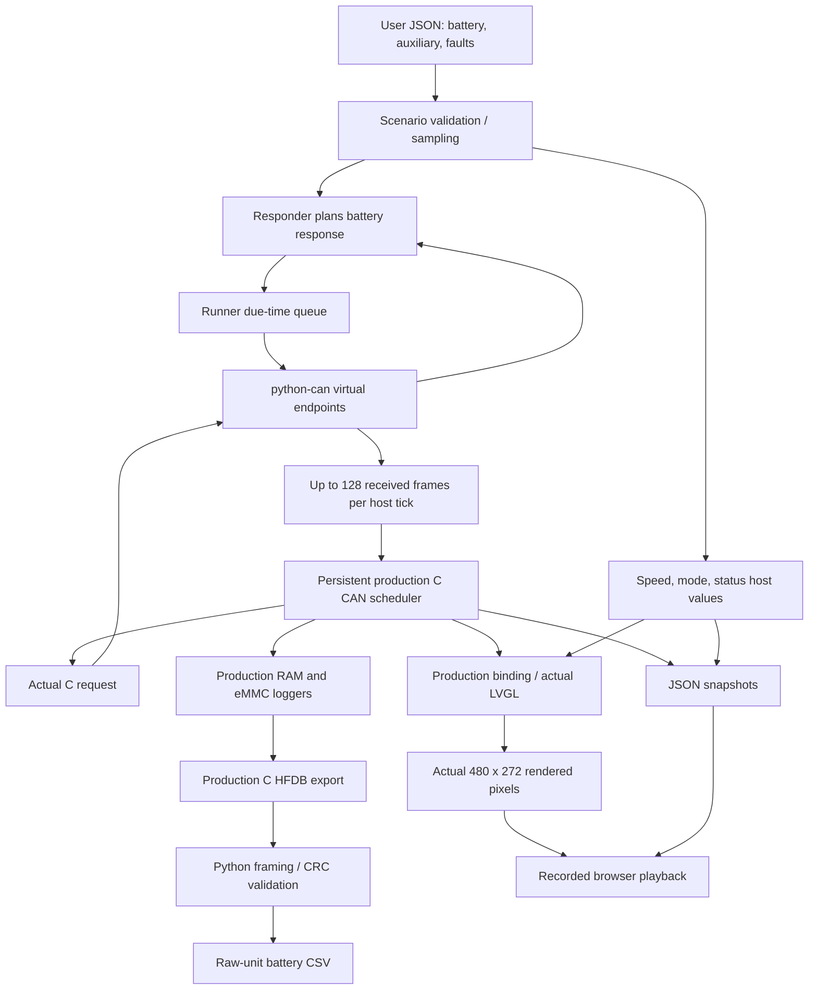

# Synthetic execution and Python code guide

## Sources, decisions and scope

This guide explains the maintained Python implementation in `tools/can_sim/`,
`tools/dashboard_sim/`, `dump_emmc_bin.py` and the eight owned `tests/test_*.py` modules.
It accompanies expanded module, class, function and method comments in those files.
Executable behavior is preserved; this documentation work does not add missing hardware bindings.

The sources read were the actual implementations and test bodies listed below, the four
checked-in JSON scenarios, [SYNTHETIC_TESTING.md](SYNTHETIC_TESTING.md) and
[BDP_GAP_ANALYSIS.md](BDP_GAP_ANALYSIS.md). Reading the implementation establishes exact
conversion, scheduling, export and failure behavior. Reading the tests establishes which
cases are asserted. The BDP report establishes the boundary between source/design agreement
and physical hardware evidence. The decision is to document these boundaries separately:
the virtual path exercises production application code, while its peripherals are host fakes.
No new vehicle encodings, electrical polarities or hardware success claims are inferred.

## What executes when the screen moves



The deterministic runner advances millisecond ticks rather than waiting for real-time CAN
or FreeRTOS execution. It calls the responder before C at each tick, delivers queued frames,
then sends any request generated by C back to the responder. That response is sampled/planned
at the same tick; the host receives it in a subsequent tick's batch. Consequently a scenario
value, accepted CAN value and displayed value need not change at precisely the same tick.
A pause or malformed response preserves previously accepted battery state; per-signal stale
or unknown metadata is not implemented in the battery contract.

The player displays saved actual LVGL pixels alongside the state associated with their capture.
It does not rerun CAN while animating. Edit the JSON and run the CLI again to generate changed
results. Playback JavaScript and the C renderer are explained in
[CODE_UI_HOST_GUIDE.md](CODE_UI_HOST_GUIDE.md).

## Package and CLI entry points

| Source | Code responsibility |
|---|---|
| [`tools/can_sim/__init__.py`](../tools/can_sim/__init__.py) | Package marker and responsibility summary. Import alone starts no endpoint. |
| [`tools/can_sim/__main__.py`](../tools/can_sim/__main__.py) | Standalone responder, optional same-process demo requests and traffic JSON lines. |
| [`tools/dashboard_sim/__init__.py`](../tools/dashboard_sim/__init__.py) | Package marker for complete host execution and captured playback. |
| [`tools/dashboard_sim/__main__.py`](../tools/dashboard_sim/__main__.py) | User JSON → host build/run → saved scenario/summary → optional browser launch. |
| [`tools/can_sim/requirements.txt`](../tools/can_sim/requirements.txt) | Pins the python-can transport dependency to 4.6.1. |

For `python -m tools.can_sim`, `_positive` parses positive finite durations/rate/request period;
`_log_frame` emits exact payload and metadata with simulation seconds. `run` opens the selected
simulation endpoints using `ExitStack`, scales monotonic wall time by `--rate`, optionally cycles
ten PID requests, dispatches replies and closes endpoints. It skips missed demo request periods
instead of issuing a catch-up flood. Its final summary reports requests received/recognized,
replies sent and pending replies remaining at stop. `main` provides argparse defaults and returns
0 for success, 130 for interrupt, or 2 for caught validation/CAN/I/O/queue failures.

For `python -m tools.dashboard_sim`, `main` reads the scenario bytes once, parses those bytes,
builds the sanitizer host and calls `run_scenario`. The same bytes become `scenario.json`,
preventing a later reread or JSON reserialization from changing the preserved input.
Its default scenario is `dashboard.json`; use `--scenario .../user-inputs.json` for the editable
10-second example. `--open` acts only after generation and launches the saved file URI.
Browser launcher failure prints the saved path and keeps the completed run successful.
Configuration/I/O/runtime errors caught by the CLI produce status 1.

The standalone CAN CLI uses paced wall time. The dashboard CLI uses deterministic host ticks.
They share protocol/scenario/engine/transport code but are different execution entry points.
The virtual backend only connects endpoints in the same process; a separately launched
standalone virtual responder does not exchange traffic with the dashboard process.

## Wire contract and unit conversion

[`tools/can_sim/protocol.py`](../tools/can_sim/protocol.py) is grounded in
[`Src/app_can.c`](../Src/app_can.c), rather than an unprovided vehicle DBC/manual.
`Signal` holds the PID, payload width, multiplier, offset and allowed engineering interval.
`SIGNALS` insertion order follows the firmware request table. `PID_SIGNALS` supplies its reverse
lookup for request recognition.

| JSON engineering input | PID | Value bytes | Multiply / offset | Accepted engineering range |
|---|---|---:|---|---|
| `pack_voltage_v` | `0xF00D` | 2 | ×10 | 0..6553.5 V |
| `pack_summed_voltage_v` | `0xF014` | 2 | ×100 | 0..655.35 V |
| `pack_current_a` | `0xF015` | 2 | ×10, then +32767 | -3276.7..3276.7 A |
| `pack_soc_pct` | `0xF00F` | 1 | ×2 | 0..100% |
| `highest_temperature_c` | `0xF028` | 1 | ×1; signed result masked into one byte | -128..127 °C |
| `lowest_temperature_c` | `0xF029` | 1 | Same | -128..127 °C |
| `average_temperature_c` | `0xF02A` | 1 | Same | -128..127 °C |
| `lowest_cell_voltage_v` | `0xF032` | 2 | ×10000 | 0..6.5535 V |
| `highest_cell_voltage_v` | `0xF033` | 2 | ×10000 | 0..6.5535 V |
| `average_cell_voltage_v` | `0xF034` | 2 | ×10000 | 0..6.5535 V |

`finite_number` explicitly rejects bool/string/non-number and nonfinite/overflowing conversion;
`validate_value` then enforces the named inclusive range. Both return floats without clamping.
`encode_response` applies Decimal round-half-up before adding offset and masking to width.
An explicit width-fitting integer `raw_override` replaces the calculated raw bytes, allowing
boundary faults such as raw SOC 255; even then the supplied engineering value is validated.

`make_request` produces standard classic ID `0x7E3`, eight data bytes:
`03 22 PID_hi PID_lo 00 00 00 00`. `request_signal` requires that ID, classic standard data framing,
DLC 4..8 equal to actual data length, PCI `03`, service `22` and a recognized big-endian PID.
Unrecognized request shapes return `None` rather than producing a reply.

Normal `encode_response` frames use standard classic ID `0x7EB`:
`(3 + width) 62 PID_hi PID_lo value_bytes zero_padding` with DLC 8. The PCI byte counts
service/PID/value bytes, excluding itself and padding. PID and value bytes are big-endian.
The current offset represents the implemented source convention; it is not signed two's
complement current. Signed temperature uses width masking. These functions build/classify
messages and never send a frame themselves.

## Editable schema and timeline code

[`tools/can_sim/scenario.py`](../tools/can_sim/scenario.py) separates input parsing from transport.
Its root object allows only `version`, `duration`, `signals`, `faults` and `auxiliary`.
Version defaults to 1 and must equal 1. Duration defaults to 10 seconds and must be finite positive.
Missing battery signals become explicit synthetic engineering zero; missing speed/mode become
`null`, and missing statuses become `unknown`.

`_object` checks JSON object shape and allowed fields without copying it. `_integer` checks raw
integer parameters, accepting explicit-base strings such as `0x123` and excluding bool/fractions.
`_unique_object` rejects duplicate keys at every nested level through `json.loads`'s
`object_pairs_hook`. Thus a repeated field cannot silently replace another input.

A numerical constant is a one-point step `Track`. Timeline objects permit `interpolation` and
nonempty `points`, each point containing `t` and `value`. Times use seconds, are finite/nonnegative
and strictly increasing. `_track` validates battery units/ranges. `Track.value_at` selects via
`bisect_right`: an exact point timestamp activates that point. Step mode holds a value;
linear mode evaluates `v0 + (v1-v0)*(t-t0)/(t1-t0)`. Values before/after the track hold its
first/last endpoint. This low-level method assumes validated tracks/time.

`_auxiliary_value` validates synthetic speed 0..65535 km/h or null, mode N/D/R or null, and statuses
unknown/ok/fault. `_auxiliary_track` allows linear mode only for numerical speed; a null speed,
mode or status transition requires step interpolation. `_auxiliary_tracks` builds all nine
tracks; `_unknown_auxiliary_tracks` allocates fresh defaults for direct three-argument Scenario
construction. Frozen dataclasses prevent attribute reassignment; they do not deeply freeze
the dictionaries in Scenario or Fault.

`Scenario.from_dict` combines all validated tracks and faults. `from_text` adds duplicate-aware
JSON decoding; `from_file` adds UTF-8 file reading. `values_at` and `auxiliary_at` validate finite
nonnegative sampling seconds and return fresh output mappings. `active_faults` selects rules
matching the request signal in `[start, end)`, preserving configuration order; it does not advance
loss counters. Public request planning validates elapsed time before calling this selector.

### Fault schema and ordering

`_fault` requires a supported type, `0 <= start < end` in seconds and an optional known signal.
Only type-specific parameter keys are accepted. The JSON-list index identifies each drop
counter independently, including rules with otherwise identical contents.

| Type | Parameters / behavior |
|---|---|
| `pause` | No type parameters; suppress matching replies. |
| `drop` | `every` defaults to 1, allowed 1..1000000; suppress each matching ordinal divisible by it. |
| `delay` | Nonnegative `seconds`, default 0.2; add to response due time. |
| `wrong_id` | Standard raw `id` 0..0x7FF, default 0x123. |
| `wrong_service` | Byte `service` 0..255, default 0x7F. |
| `wrong_pci` | Byte `pci` 0..255, default 0x25. |
| `short_dlc` | `dlc` 0..7, default 3; truncate actual payload and metadata together. |
| `unknown_pid` | `pid` 0..0xFFFF, default 0xFFFF; must be absent from the implemented PID table. |
| `duplicate` | Extra `count` 1..1024, default 1; nonnegative `spacing` seconds, default 0. |
| `burst` | Total contribution `count` 1..1024, default 32; adds count−1 extra copies. |
| `raw` | Requires target `signal`; integer `value` defaults to 0 and must fit that payload width. |

[`tools/can_sim/engine.py`](../tools/can_sim/engine.py) defines `ScheduledResponse(due, message)`
and two responsibilities. `Responder.__init__` owns the scenario and drop counter dictionary.
`Responder.plan` validates elapsed seconds, recognizes the request, counts every active matching
drop rule, then applies pause/drop suppression. It samples the input at request time, not delivery
time. Delays add; duplicate/burst copies add; duplicate spacing is the largest active spacing.
Combined copies above 4096 fail explicitly. A raw override and same-field mutations follow
configuration order. Header mutations happen before truncation regardless of JSON fault order;
multiple short-DLC faults choose the smallest length. Each returned message is a deep copy.
Planning sends nothing to a bus.

`Runner.__init__` accepts a caller-owned bus, responder and positive `max_pending` default 4096.
It owns a `(due, sequence, Message)` heap so equal due times retain insertion order without
comparing Message objects. `pending` is the current heap length. `_send_due` sends at most 512
ready entries with a 0.05-second bus timeout. An entry is popped before send; a failed send is
not automatically requeued. `step` rejects clock reversal, sends queued due entries, drains at
most 256 requests, checks queue capacity before inserting each request's plans, then sends newly
due entries. Each of its two send phases is capped at 512. It returns actually sent messages and
tracks received/recognized/sent counts. Queue overflow and transport errors propagate.

## Transport boundaries

[`tools/can_sim/transport.py`](../tools/can_sim/transport.py) provides `open_bus` and `validate_vcan`.
Channel strings must be nonempty and at most 128 characters. `open_bus("virtual", ...)` creates
a python-can same-process bus with 1024 receive slots and `receive_own_messages=False`.
`ignore_config=True` prevents environment/user settings selecting another backend.

`socketcan` is accepted only after `validate_vcan` checks a name matching `vcan[0-9]+`, Linux,
class/net symlink resolution into devices/virtual/net, type text 280, no device node, and a
five-second `ip -details -json link show dev` result with exactly one matching `info_kind=vcan`.
Missing, inconsistent or malformed evidence raises ValueError. Tests inject a temporary sysfs
root and mocked ip result; no interface is created by validation. Other backends are rejected.
The actual adapter/BMS/DBC binding remains deferred as requested.

## Persistent host and artifact pipeline

[`tools/dashboard_sim/runner.py`](../tools/dashboard_sim/runner.py) contains `build_host`, `Host`,
`ppm_to_png`, nested PNG `chunk`, `write_viewer` and `run_scenario`.

`build_host` prefers CMake beside the active Python executable, then PATH, configures the
sanitizer-enabled host into `build/dashboard-host` and builds with eight jobs. Each command has
a 180-second timeout and captured diagnostics. It returns the host executable path. The build
folder is shared: simultaneous configure/build calls into that same folder are not part of the
runner's synchronization contract.

`Host.__init__` starts C with text stdin/stdout and a temporary stderr file so large sanitizer
output cannot block a pipe. `__enter__` returns the instance. `command` appends/flushed newline,
waits at most ten seconds and parses one JSON stdout line; timeout kills C, and EOF/malformed
responses produce diagnostic RuntimeError. Commands must be sequential. `__exit__` sends Q,
waits five seconds, kills on timeout/broken pipe and closes handles. A prior context exception
is preserved; a nonzero process exit otherwise raises a diagnostic RuntimeError.

`Host.step` converts auxiliary engineering values into this host API:

```text
T tick_ms speed mode valid_mask fault_mask receive_count
hex_ID extended remote FD hex_payload
... one frame line per receive_count
```

Speed is rounded with `floor(kph + 0.5)`; unknown is −1. Modes map null/N/D/R to −1/0/1/2.
Status bit order is imd, fault, rtd, tsal, bspd, sdc, ready_to_drive. Known sets the valid mask,
and fault sets the fault mask. This bit layout is a host C/Python contract rather than invented
vehicle CAN IDs. More than 128 frames in one batch raises ValueError. An empty payload is `-`.
C validates the serialized numeric/token ranges separately.

`Host.artifact` sends `P absolute_path` for the PPM capture or `E absolute_path` for binary export.
It rejects CR/LF path characters, preserves ordinary spaces and requires an `ok` response.
`ppm_to_png` accepts only the exact renderer's P6/255/480×272 RGB bytes, writes zero-filter rows
and lossless zlib PNG chunks. Nested `chunk` packs big-endian payload length and CRC over
chunk type+payload. PNG checksums are independent of eMMC export checksums.

`run_scenario` validates duration, step (1..1000 ms), capture interval (nonnegative, zero off),
rounded 32-bit end tick and at most 100001 steps before opening C. It includes an irregular final
tick. Captures occur at eligible ticks at/after each interval and at the end; with 10-ms default
steps and 100-ms captures the recording is ten frames per second. Larger steps can quantize
capture times. It enumerates all artifacts before rejecting protected-source aliases, including
hard links, then opens a unique virtual channel and C instance.

Each tick saves the returned C state and exact sampled auxiliary input to `snapshots.jsonl`.
If C reports an update but not a successful log append, the run fails explicitly. The fake eMMC
region has 64 blocks, not the physical card capacity; the actual host C details are in the
[UI/host guide](CODE_UI_HOST_GUIDE.md). Captured PPM and PNG files use the tick in their basename.

After C produces `log.bin`, Python `read_dump` validates framing and aggregate stream CRC.
The runner additionally requires every stored/dump record validity flag true before writing
CSV/playback/summary. The standalone exporter reports invalid row flags instead of automatically
failing them; this is a deliberate difference between validation entry points.

| Artifact | Meaning |
|---|---|
| `scenario.json` | Exact input bytes preserved by the dashboard CLI. |
| `snapshots.jsonl` | Every host tick's decoded/logged/UI state plus supplied auxiliary values. |
| `frame-<tick>.ppm`, `.png` | Actual LVGL framebuffer RGB and its lossless PNG representation. |
| `log.bin` | Production C binary exporter against fake eMMC. |
| `log.csv` | Decoded raw-unit battery records and validity flags, not auxiliary inputs. |
| `index.html` | Offline recorded player with inline JSON/code and relative PNG paths. |
| `summary.json` | Duration, steps, requests/replies, records, session, captures and output path. |

`write_viewer` inlines playback code before inserting capture data, replacing each template marker
once. It escapes `<` in the JSON to avoid closing a script element from a data value. It packages
existing recorded results rather than computing new samples. Existing artifact names are replaced;
validation failure later in a run can leave partial local outputs.

## Binary dump decoder and exports

[`dump_emmc_bin.py`](../dump_emmc_bin.py) imports optional pyserial and openpyxl. Their absence
sets the corresponding API reference to None, keeping offline decoding available. It defines
little-endian struct schemas and ordered `RECORD_FIELDS` used by rows and tabular exports.

| Region | Struct | Bytes | Validation |
|---|---|---:|---|
| Header | `<4sHHIIHHI` | 24 | HFDB, version 1, declared header 24/record 42, header CRC. |
| Wire record | `<I5H7hBbbbBBII` | 42 | Ordered integer data/flags/stored CRC; final dump CRC over preceding bytes. |
| Footer | `<4sIII` | 16 | HFDE, footer CRC; count and stream CRC checked against reader state. |

The wire record differs from the stored 40-byte record. Fields retain timestamp milliseconds,
pack decivolts, cell 100-µV counts, current deciamps, integer kW, SOC, signed Celsius and flags.
`crc32_bytes` returns unsigned binascii CRC32. `read_exact` performs one required-size read and
fails on short data; it does not retry accumulating partial reads. `wait_for_header` scans a
rolling four-byte window through preceding UART data until HFDB or a monotonic deadline,
then reads the remaining header.

`unpack_header` validates framing/sizes/CRC and returns session/count/flags/version.
`unpack_record` returns named fields, `dump_crc_valid` and `stored_crc_valid`; the latter is the
firmware verdict in record_flags bit 0, not Python independently rechecking stored layout CRC.
`unpack_footer` validates magic/own CRC. `read_dump` consumes the declared records and footer,
optionally copies raw bytes, accumulates stream CRC over every complete wire record with initial
binascii state zero, then checks count and stream CRC. Row flags are returned even if false.
It does not itself inspect bytes beyond the footer.

`write_csv` always writes field/validity headers and raw integer units. `write_xlsx` returns False
without writing if openpyxl is absent, otherwise creates/saves an eMMC Dump sheet and returns True.
`parse_args` requires exactly one UART or offline source. `main` derives export paths, rejects
offline input aliases and trailing bytes, then prints summaries and invalid-row counts. The
existing optional UART path resets buffers, waits 0.2 seconds, writes ASCII `b`, scans HFDB and
reads the stream. Synthetic execution never invokes that hardware path; tests supply BytesIO
FakeSerial. Validation/I/O/serial failures propagate and late failure can leave partial exports.

## Checked-in scenarios

| JSON | Defined inputs/cases |
|---|---|
| [`user-inputs.json`](../tools/can_sim/scenarios/user-inputs.json) | 10-second example: current and speed ramps, N/D/R mode steps, IMD fault/recovery and 7..8-second CAN pause. |
| [`normal.json`](../tools/can_sim/scenarios/normal.json) | 10-second battery ramps/step SOC with no traffic faults; auxiliary defaults unknown. |
| [`edge_cases.json`](../tools/can_sim/scenarios/edge_cases.json) | 20-second engineering extrema and all eleven fault types, including raw current/SOC overrides. |
| [`dashboard.json`](../tools/can_sim/scenarios/dashboard.json) | 20-second battery/auxiliary stress input: every status exercises unknown/ok/fault/recovery alongside traffic faults. |

These examples define particular cases. They do not establish exhaustive coverage of all possible
CAN ordering, physical errors, task schedules or power-loss events.

## Test code and coverage

All 100 functions/methods in the eight owned test modules have expanded descriptions of their
specific fixtures, expected outcomes and relevant side effects. Their 81 `test_` methods are
unittest cases; setup/helper/fake-interface methods support those cases. Assertion success
returns None; failures or unexpected errors mark the case failed. Comment expansion does not
remove assertions, add skips or mock additional boundaries.

| Source | Cases | What its code checks |
|---|---:|---|
| [`test_aux_scenario.py`](../tests/test_aux_scenario.py) | 17 | Unknown defaults, independent constants, all mode/status steps, speed ramp/endpoints, null transitions, range/types/shape/order, duplicate keys, fresh mappings and examples. `scenario` builds a parsed fixture. |
| [`test_can_sim.py`](../tests/test_can_sim.py) | 19 | Exact ten PID wire encodings, request recognition, normal/raw extrema, schema validation, endpoint/step timing, interval targeting, request-time sampling and every response-fault mechanism. `responder` gives rules a common 1..2-second interval. |
| [`test_can_sim_bus.py`](../tests/test_can_sim_bus.py) | 12 | Genuine virtual round trips, delay/pause, duplicates/short frames, queue limit and clock reversal. Fake sysfs/iproute2 fixtures test guard acceptance/rejection; CLI subprocesses test demo and physical-channel rejection. |
| [`test_can_pipeline.py`](../tests/test_can_pipeline.py) | 4 | Compile the production C decoder adapter with strict warnings/ASan/UBSan. `replay_bus` carries actual bytes through virtual CAN; `decode_frames` sends metadata/ticks to C. Check ten conversions, statistics, malformed state preservation and fault recovery. |
| [`test_dashboard_cli.py`](../tests/test_dashboard_cli.py) | 4 | Mock completed host execution and launcher, preserving exact input bytes. Check explicit launch, no default browser side effect, False launcher result and browser exceptions. `run_command` captures stdout/stderr and space-containing file paths. |
| [`test_dashboard_playback.py`](../tests/test_dashboard_playback.py) | 1 | Require Node and propagate the JavaScript playback regression suite's exit status. A missing runtime fails instead of silently skipping. |
| [`test_dashboard_sim.py`](../tests/test_dashboard_sim.py) | 7 | Build the full host once; assert actual LVGL labels/pixels, CAN/logging/export, unknown/fault recovery, parser overflow/payload rejection, input/hard-link protection, run bounds and default capture timestamps. |
| [`test_storage_export.py`](../tests/test_storage_export.py) | 17 | Compile production logger adapter under sanitizers and load the actual Python exporter. Check retained tails/block boundaries/capacity/reset/usage/retries/empty session, stored vs wire corruption, signed fields, frame/count/version/truncation errors, offline source protection and fake-UART CLI. |

Storage `capture` selects C adapter modes and returns stdout bytes; `unpack_rows` checks fixed
length/offsets separately from the complete stream validator. Nested FakeSerial constructors
wrap captured bytes; reset methods intentionally do nothing; `write` requires exactly ASCII b
without altering the input stream. The helper therefore tests the export request while opening
no serial hardware. C compilation helpers clean up their temporary executables after their suite.

## BDP applicability and current verification limits

The supplied BDP evidence is incorporated through the board/source comparison and gap reports.
The synthetic path uses the source's production CAN request/decoder, production loggers and
480×272 LVGL screen; it does not load the Altium files as a machine simulator. The host fake
peripherals do not validate PH13/PH14 routing, transceiver/termination/harness, measured bitrate,
LCD timing, SDRAM refresh, QSPI programming, physical eMMC writes, DMA/cache or concurrent RTOS tasks.
See [BDP_HARDWARE_EVIDENCE.md](BDP_HARDWARE_EVIDENCE.md) and
[BDP_GAP_ANALYSIS.md](BDP_GAP_ANALYSIS.md) for actual sourced design facts and remaining work.
Physical hardware behavior/connection safety is **Insufficient data to verify** from this run.

## Documentation-change verification evidence

- Read all 18 owned Python source files and the four scenario JSON files before editing.
- Expanded module context, class contracts and all **156 functions/methods**: **56** implementation
  functions and **100** test/setup/helper functions. Added inline comments for byte framing,
  point boundaries, heap ordering, host conversion, closed-loop tick ordering and export validation.
- Compared each file with `build/documentation-review/baseline.json` using parsed Python ASTs
  after removing only module/class/function docstrings. Executable ASTs were identical for all
  **18 files**. Python comments do not appear in those ASTs; attributes, expressions, assertions,
  handlers, imports and function signatures were retained.
- Ran **53 independent Python tests** successfully: auxiliary scenario, CAN encoding/planning,
  virtual bus/guard/CLI, dashboard CLI and the Node playback wrapper. The wrapper executed the
  existing JavaScript test runner successfully. No shared CMake host build was launched by this
  documentation agent. Full integration verification is recorded by the root in the code guide.
- Original upstream dependencies, JS/HTML, scenario values and physical binding were not changed
  by this owned documentation work.
