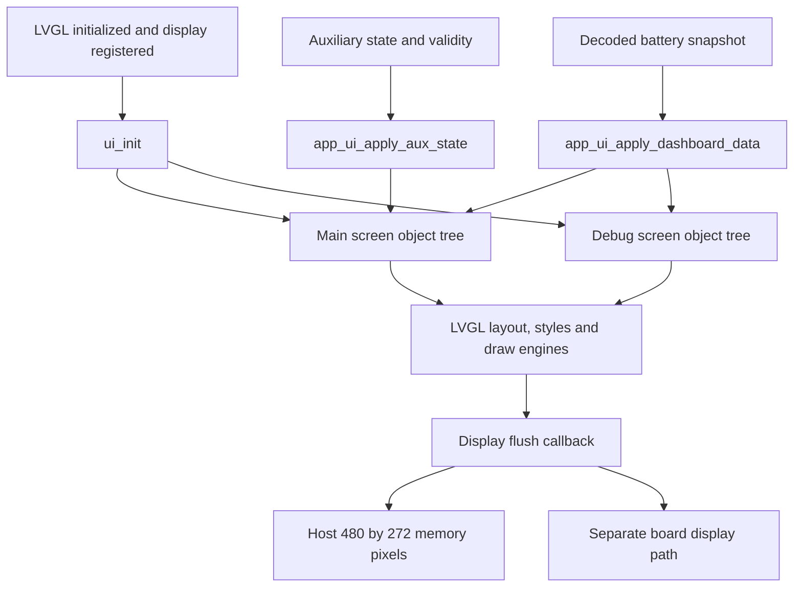

# UI, host simulator and recorded playback: code guide

## Sources inspected and implementation decision

Read the maintained source in `ui/`, `tools/dashboard_host/`, the three C test harnesses,
`tools/dashboard_sim/playback.js` and its Node tests, plus the current application binding,
local LVGL image/font/display APIs, `BDP_HARDWARE_EVIDENCE.md`, `BDP_GAP_ANALYSIS.md` and
existing synthetic integration/playback evidence. The source establishes how widgets,
frames, memory blocks and recorded images interact. The BDP establishes board design
connections, not successful operation of a physical board.

This change expands documentation only. Each implemented function now explains its purpose,
inputs/units, output, state changes, guards and relevant execution ordering. Matching
maintained header declarations carry the same interface contracts. Generated constants keep
their exact bytes; comments explain their descriptor/table structure instead of inventing a
meaning for each pixel or font byte. The project-wide function inventory supplies individual
function locations and call/reference links; this guide explains the module boundaries and
larger data flow.

## Three distinct layers of the dashboard screen

| Layer | Source | What it owns |
|---|---|---|
| Application binding | `Src/app_dashboard_ui.c`, `Inc/app_dashboard_ui.h` | Formats a decoded battery snapshot, auxiliary validity/speed/mode/status and storage usage into existing widgets. Shared by firmware and host. |
| Generated object tree | `ui/ui.c`, `ui/screens/ui_MainScreen.c`, `ui/screens/ui_DebugScreen.c` | Creates screens, panels, labels, layered gauge images, geometry/styles/fonts and navigation callbacks. Receives already-decoded values through setters; contains no CAN decoder. |
| Display backend | Board `Src/Lvgl_Porting/` or host `tools/dashboard_host/render.c` | Registers an LVGL display and flush callback. Board drives actual peripherals; host copies actual LVGL pixels into memory and writes captures. |

`ui_init()` requires LVGL and a default display to exist. It registers the custom component
lookup event, optionally installs the default theme, creates main and debug screen trees,
creates the separate initial-actions object and loads main. Generated initialization has
no repeated-call/allocation-failure API. The host display wrapper guards repeated
initialization before calling it. `ui_destroy()` deletes the two active trees; the display
owner separately deletes the initial-actions object and removes its display.

## Main and debug screen objects

The main screen uses a black root with center-relative pixel positions. Eight panels are
created before their corresponding labels: seven status backgrounds and one drive-mode
background. Status labels are siblings on the root rather than children of those panels;
therefore the application binding explicitly changes both label and panel visibility.
The generated green borders, `120` speed and `N` mode are creation defaults, overwritten
by application state before host capture. The existing BSPD caption is `BSPB` in the source;
this documentation change does not alter that string.

Each of temperature, the displayed power scalar and battery level has a noninteractive
container with three image layers: recolored fill, movable mask/knob and fixed outline.
`ui_clamp_slider_value()` bounds the scalar to 1..100; `ui_slider_value_to_y()` maps it
with integer arithmetic from -5 to -147 pixels. Larger values move upward. Temperature
and the power-named scalar use green through 40, orange through 65 and red above 65;
battery level reverses green/red. Those constants are presentation thresholds, not
verified vehicle alarm limits. The setters modify existing objects and never allocate
new gauges. A missing knob skips the gauge update; a missing fill skips only its color write.

The application currently passes highest temperature, current magnitude in amps and SOC
to these gauges. The caption `PWR kWh` does not implement energy integration and does not
match that current-magnitude quantity. The remaining unit decision is recorded in
`BDP_GAP_ANALYSIS.md`; no requirement is guessed or behavior changed by this explanation.

Auxiliary speed is integer km/h; mode is internal N/D/R. Missing validity produces dashes
and unknown mode styling. During the initial 3000 ms boot interval or while inputs are
uninitialized all seven status indicators are shown. Afterwards **all seven are hidden
only if every signal is valid and healthy**. If any is unknown or faulted, all seven
are shown: each independently has a gray unknown, red valid-fault or green valid-healthy
border/text color. This is group-wide visibility, not individual hiding of healthy panels.
The host supplies explicit synthetic auxiliary state; firmware still has its existing
placeholder provider. Actual vehicle/GPIO bindings remain deferred.

The debug root contains a generated frame image and twelve labels in four three-column
rows. Application formatting displays high/average/low cell voltage rounded to millivolts,
signed Celsius temperature and signed integer kW statistics. The legacy `DebugSpeedHigh`
and `DebugSpeedAvg` handles display RAM/eMMC usage percentages. `DebugSpeedLow` retains its
generated zero in the current application binding. Handle names do not establish units.
Main/debug long-press callbacks lazily create the other screen when absent, then request
a 100 ms fade without auto-deleting the previous screen. The memory host does not register
a physical touch-input driver.

`ui_show_main_screen_slider_demo()` writes a fixed visual example. The separate
`ui_step_main_screen_slider_demo()` keeps static demo directions/values and advances at
most once per eligible 40 ms LVGL interval. It does not consume scenario inputs or CAN.
Static demo state survives screen teardown, while destroy functions delete root-owned
children and set every object handle to NULL.

`ui/screens/ui_Screen1.c` is a retained legacy image-only screen excluded from current
source lists. Its `ui_Image1` definition duplicates the active debug source name; adding
it unchanged to the same target would collide. It is explained without being enabled.

## Generated helper/component interfaces

`ui_helpers.c/.h` groups generic generated operations: bar/basic/dropdown/image/label/
roller/slider property setters, screen lifecycle, increment operations, keyboard/textarea,
flags/states, opacity, animation getters/setters, label formatting, spinbox and optional
theme switching. IDs determine the property; unsupported setter IDs make no write.
Flag/state modifiers clear for selectors other than add/toggle. Feature macros compile
some widget bodies into no-ops. These wrappers generally require valid LVGL objects;
there is no general object-null validation layer.

Increment helpers read the old value, apply the delta through LVGL and, for arc/slider/
spinbox, explicitly emit `LV_EVENT_VALUE_CHANGED` afterwards. Text helpers format through
a 32-byte stack buffer where used, then LVGL copies the text. Animation callbacks receive
`ui_anim_user_data_t` containing a target, optional image-set pointer/size and saved frame
value. Coordinate/size/opacity/zoom/angle setters write the target directly. Image frame
selection clamps the lookup index but retains the requested raw index for the getter;
the image set must be nonempty. The cleanup callback frees its allocated user data and
clears the pointer. It must not receive static/shared allocations.

`ui_Label1_create()` makes the reusable label and allocates a one-entry child-pointer
array. A custom event returns a requested child synchronously through the event parameter;
the delete event frees the pointer array while LVGL owns the widget tree. Lookup has no
index bounds check: the factory's constants define valid indices. The creation hook is
intentionally empty. `ui_events.h` currently adds no separate event declarations.

## Font/image constants and UI build metadata

Font files contain coverage bitmap bytes, glyph descriptors (offset/advance/box metrics),
Unicode-to-glyph maps and kerning classes. `font_dsc` connects those tables and the public
`lv_font_t` points to upstream LVGL lookup functions. Version/configuration guards select
the generated descriptor layout. All checked-in custom fonts use 8-bit glyph coverage.
The active target selects TomorrowBoldItalic12/14/18/26/64; Mons110 remains excluded.
The pixel-size name differs from maximum line height, which includes font metrics:
12→13, 14→16, 18→23, 26→31, 64→75; Mons110 line height is 128. These are asset constants,
not speed/voltage values.

Image arrays are generated raw pixels used by `lv_img_dsc_t`, not PNG files decoded at
runtime. The descriptor establishes actual dimensions/color format/byte size/data pointer.
All eight image descriptors use `LV_IMG_CF_TRUE_COLOR_ALPHA`:

| Image | Descriptor dimensions | Current role |
|---|---:|---|
| rectangle_27 | 62×157 | Gauge fill |
| subtract | 62×150 | Gauge movable mask/knob |
| rectangle_24 | 66×161 | Gauge outline |
| debugframe | 460×246 | Debug background; the old width/height source comments include a stale 122 height, while the descriptor is authoritative |
| frame_1 | 480×272 | Excluded legacy Screen1 background |
| fs_dashbord_hard | 480×272 | Excluded asset |
| ellipse_6 | 185×185 | Excluded asset |
| rectangle_6 | 7×61 | Excluded asset |

`ui/CMakeLists.txt` and `ui/filelist.txt` select the same active screens/helpers/component
and four images/five fonts. The CMake target is consumed by firmware and host; callers
supply LVGL include/link settings. `ui/project.info` records generated project/export
metadata; it is not runtime configuration and its reported generator version does not
replace the checked-in LVGL version. Generated asset alignment/large-constant macros
participate in the firmware memory layout; the host reads the same bytes without QSPI.

## Host executable command flow

`tools/dashboard_host/CMakeLists.txt` builds the checked-in LVGL core/widgets/draw engines,
generated UI, production CAN/configuration, RAM/eMMC loggers and portable UI binding.
Host include ordering substitutes minimal HAL/BSP/RTOS interfaces. Firmware startup,
interrupts and FreeRTOS tasks are excluded. ASan/UBSan instrumentation covers executable,
UI and LVGL for supported Clang/GNU compilers. The separate UI test target keeps assertions
enabled with `-UNDEBUG`.

`main.c` holds one production snapshot for the process and executes newline-delimited
commands sequentially:

| Command | Inputs | Execution/output |
|---|---|---|
| `T` | Absolute uint32 ms; speed -1 or 0..65535 km/h; mode -1 or 0..2; valid/fault masks 0..127; RX count 0..128, then exactly that many frame lines | Set clock → production CAN poll → if updated, RAM append/eMMC append → apply battery and explicit auxiliary UI → LVGL time/timers → one flushed JSON snapshot |
| frame line | Hex ID up to 29 bits, 0/1 extended/remote/FD metadata and even hex bytes or `-` | Validate fields/canonical DLC and enqueue before polling; production protocol validation decides accepted telemetry |
| `P path` | Ordinary file path | Refresh current LVGL display, write binary RGB PPM; JSON `ok` reports file result |
| `E path` | Ordinary file path | Reset captured UART sink, invoke production binary dump and save the captured bytes; JSON `ok` reports result |
| `Q` | No extra fields | Exit loop and tear down renderer |

The T parser bounds integers before narrowing, requires exactly six fields and nondecreasing
timestamps. `read_frame()` requires a newline, five fields and a canonical payload length;
its 64-byte local scratch supports every HAL DLC code. Bad commands/frames return process
status 2; initialization/stream failure returns 1. JSON functions escape quotes/control
bytes, query actual LVGL label text and report panel hidden flags/effective RGB color.
One pending actual production request is consumed when printing a step; Python sends it
through the virtual responder. Labels/images do not reconstruct another dashboard model.

## What each host fake substitutes

| Boundary | Implementation/state | Deliberate limitation |
|---|---|---|
| HAL millisecond clock | `host_tick`, replaced by the T runner | No real wait or board clock measurement |
| CAN receive | 128-entry batch, canonical DLC metadata and up to 64 copied bytes; read/write indices reset when drained | No hardware acceptance filter, arbitration, bit timing, electrical faults, FIFO interrupts or controller register behavior |
| CAN transmit | One captured header/eight-byte request; pending flag cleared on consume | Free-slot query always says one; AddMessage rejects an unconsumed pending capture |
| Clock/controller/filter/start/GPIO initialization | HAL_OK/no-op stand-ins | Invocation is possible; peripheral configuration success is not verified |
| RTOS mutex/critical sections | Nonnull token checks; no-op critical sections | No scheduler, blocking, ownership or concurrency exclusion |
| MMC | 64×512-byte array at production logical blocks 4096..4159; initialization fills 0xFF | No card identification, DMA/cache, busy state, timing or persistence after process exit |
| UART export | Bounded 65536-byte `wire` sink; saved to ordinary binary file | No serial device, timeout/baud/partial-transmit behavior |

The MMC card-info stub reports 4160 total blocks solely to bound the logger's reserved
region at its fixed 4096 start. One of those 64 blocks is header; 63 data blocks hold
12 current 40-byte records each, giving 756 records. This is a test capacity, not the
BDP's physical eMMC capacity. Range checks use guarded subtraction before block copying.
Export sink overflow returns HAL_ERROR; file opening, short writes and close failure
produce false. The fakes do not certify the FreeRTOS acquisition/UI/export interactions.

`render.c` registers a 480×272 display with a 480×32 partial draw buffer. LVGL flush areas
have inclusive bounds and original source stride. The flush callback clips only destination
coordinates, copies into the retained framebuffer and reports synchronous completion.
`dashboard_render_step()` increments LVGL by unsigned elapsed simulated milliseconds,
then processes timers. Capture forces refresh and serializes RGB565 via LVGL's own color
conversion to P6 RGB rows. Shutdown deletes generated trees, the separate initial object
and the display; repeated init/shutdown have explicit guards.

The host uses the supplied BDP's nominal display dimensions and production application
configuration/algorithms. It does not execute BDP-specific LCD timing, QSPI, SDRAM,
eMMC electrical/peripheral startup or the CAN transceiver. Board-design agreement and
physical operation are separate; current display-timing/memory-profile gaps are in the
BDP evidence and gap analysis. Physical board operation: **Insufficient data to verify**.

## Recorded movement in the browser

`playback.js` has no CAN adapter. Python embeds it and capture metadata in the saved
viewer; PNG files remain beside the HTML. `createPlayback()` is a closure around scenario
start/end/position, playing, speed, loop, last wall time and pending animation ID. Its
injected environment supplies a monotonic millisecond clock and frame scheduling.
`frameIndex()` finds the last capture at or before the playhead with binary search,
so irregular capture gaps still use recorded time. Pixels are not interpolated.

Elapsed wall time multiplied by speed advances scenario position. Pause accounts for
elapsed time before cancelling; seek clamps and resets the wall origin; speed change
accounts for old-speed time first; nonlooping completion clamps at the final capture.
Loop overshoot is preserved modulo duration. Empty/single/zero-duration recordings do
not start an animation chain. `getState()` returns a snapshot; `publish()` sends it to
the renderer synchronously.

`mountPlayback()` binds slider, play/replay, speed and loop controls and observes reduced
motion for initial autoplay only. Loading uses a separate Image candidate and a monotonically
increasing version token. A successful current candidate replaces the image and writes
that same capture's decoded JSON/timestamp in one callback. Obsolete completion/error
callbacks cannot replace a newer seek. The playhead can advance while the prior correctly
paired image/state remain visible. A current image error pins the failed timestamp before
pausing, hides pixels, clears decoded state and displays the missing filename. Seek to
another successful capture restores the image/error display. Controls change recording
playback; edit scenario JSON and rerun to generate changed CAN/input behavior.

## C and JavaScript test harnesses

`tests/can_host/test_app_can.c` includes the production CAN/config sources so private
helpers are tested without duplicating conversion logic. Its fake clock/FIFO/transmit and
five initialization failure stages support exact request/filter assertions, exhaustive
current/SOC/temperature domains, PCI/DLC/metadata rejection, signed power/statistics,
50 ms requests, strict >100 ms timeouts, unsigned tick rollover, TX retries, RX bursts/errors,
unsolicited/pending responses and the HAL's 64-byte copy boundary. CHECK increments the
assertion counter and returns false on the first failure in a group; main continues other
groups and reports failure totals. The separate `--overflow` entry and CTest target isolate
payload bounds. `--replay` parses bounded frame lines and prints the actual retained C
snapshot per input; it does not enforce dashboard T's nondecreasing timestamp rule.

`tests/dashboard_ui/test_binding.c` supplies only storage-count/status stubs while using
actual UI binding/LVGL/rendering. It asserts all seven independent status mappings and
group-wide visibility, unknown replacement, valid/invalid modes, retained demo timing,
signed labels/cell rounding, large/zero storage percentages, PPM header/size and capture
failure/idempotent teardown. The output image is a real LVGL-rendered file.

`tests/storage_host/test_app_emmc_log.c` includes the production logger, uses eight RAM
blocks and a bounded UART buffer, and injects header/data/read/UART errors. Its scenario
argument selects partial/slots/automatic/reset/status/capacity/errors/empty/corrupt/CSV
cases. Distinguishable signed/unsigned samples prove C-to-Python parsing and CRCs.
Assertions inspect persisted header counts/last timestamp and retained-tail status,
then stdout receives the production binary stream for Python checks. Mutex stand-ins
are intentionally sequential and do not establish concurrent safety.

`tests/dashboard_playback/test_playback.js` loads the actual playback module through Node.
The fake clock queues callbacks until explicitly advanced; newly scheduled callbacks wait
for the next advance. `elapse()` moves wall time without callback dispatch for late-error
cases. Minimal DOM/Image classes store properties/listeners and permit controlled load/error
completion order. Seven cases verify irregular timestamps/looping, controls/elapsed time,
nonlooping completion/replay, stale-image rejection, delayed image failure/recovery,
empty/single recordings and reduced-motion/manual controls. These unit stand-ins do not
replace the separately recorded real-browser verification.

## Verification for this documentation change

Compared **55 assigned C/header/CMake/JavaScript files** with the source baseline saved in
`build/documentation-review/baseline.json`. **50 contained expanded documentation, with zero
executable-token differences**. String/character literals are retained while only comments
and irrelevant token-spacing are excluded; CMake comparison also excludes comment lines.
No executable statement, assertion, numeric constant, generated pixel/glyph byte or build
configuration directive was changed. An additional maintained-definition scan found **165 C
function definitions**, each with an adjoining input/return/state contract. The ignored comparison script/report are
`build/documentation-review/check_ui_host_documentation.py` and
`build/documentation-review/ui-host-verification.json`.

Executed `node --test tests/dashboard_playback/test_playback.js`: **7 passed, 0 failed,
0 skipped** after comment expansion. No shared host build ran while other agents were
editing firmware/tool comments. Root integration verification supplies current full-suite,
C compilation and generated-inventory results. Existing physical/peripheral limits remain
unchanged because this change is documentation only.
