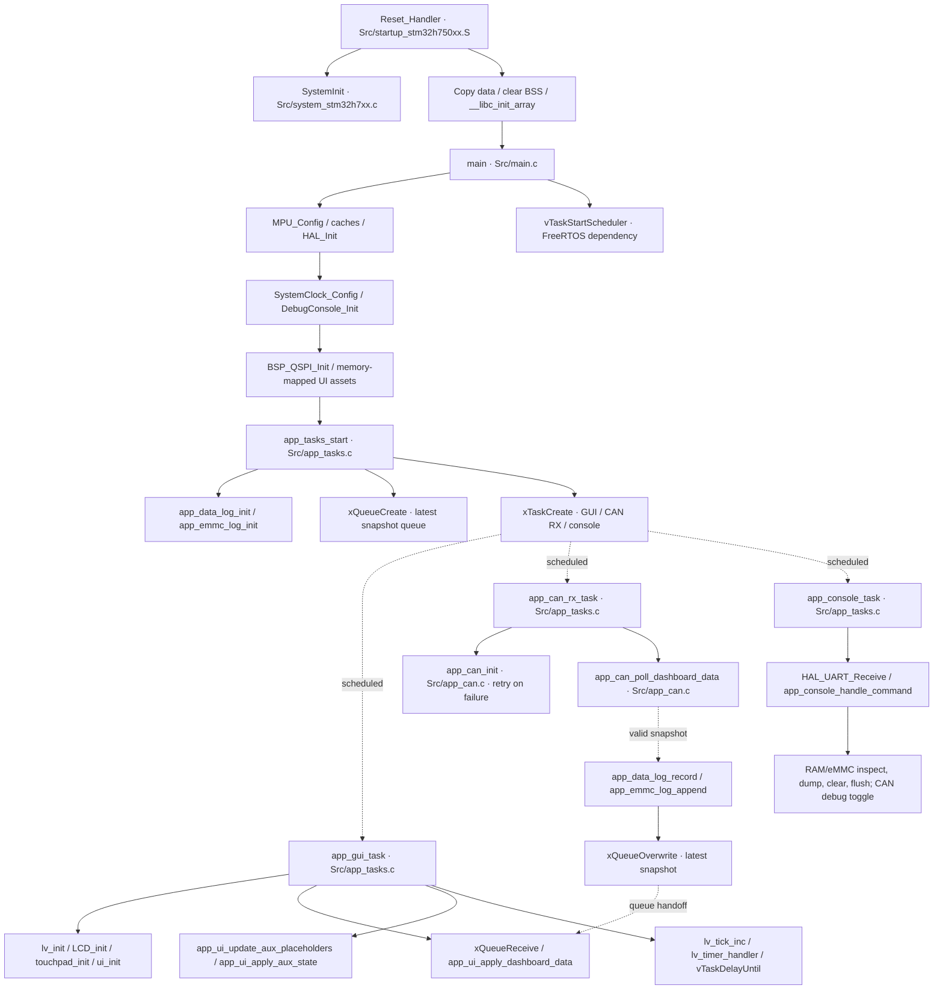
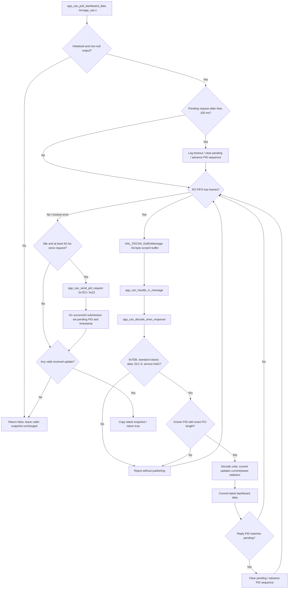
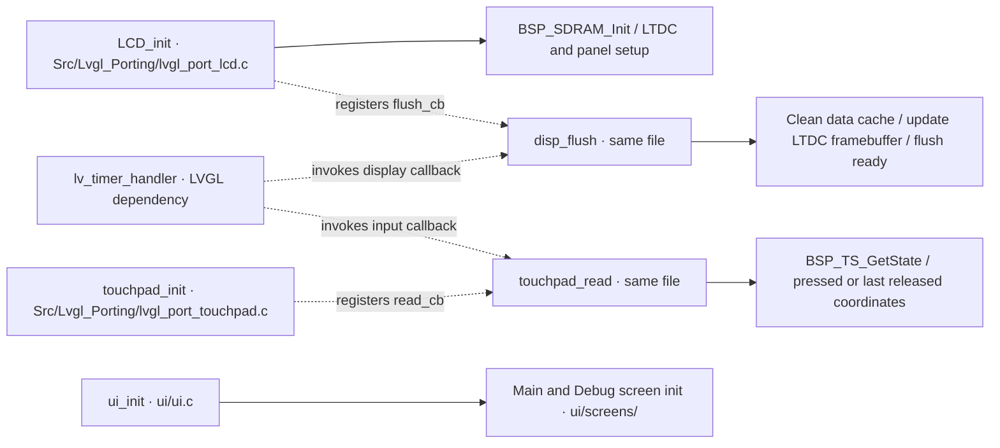
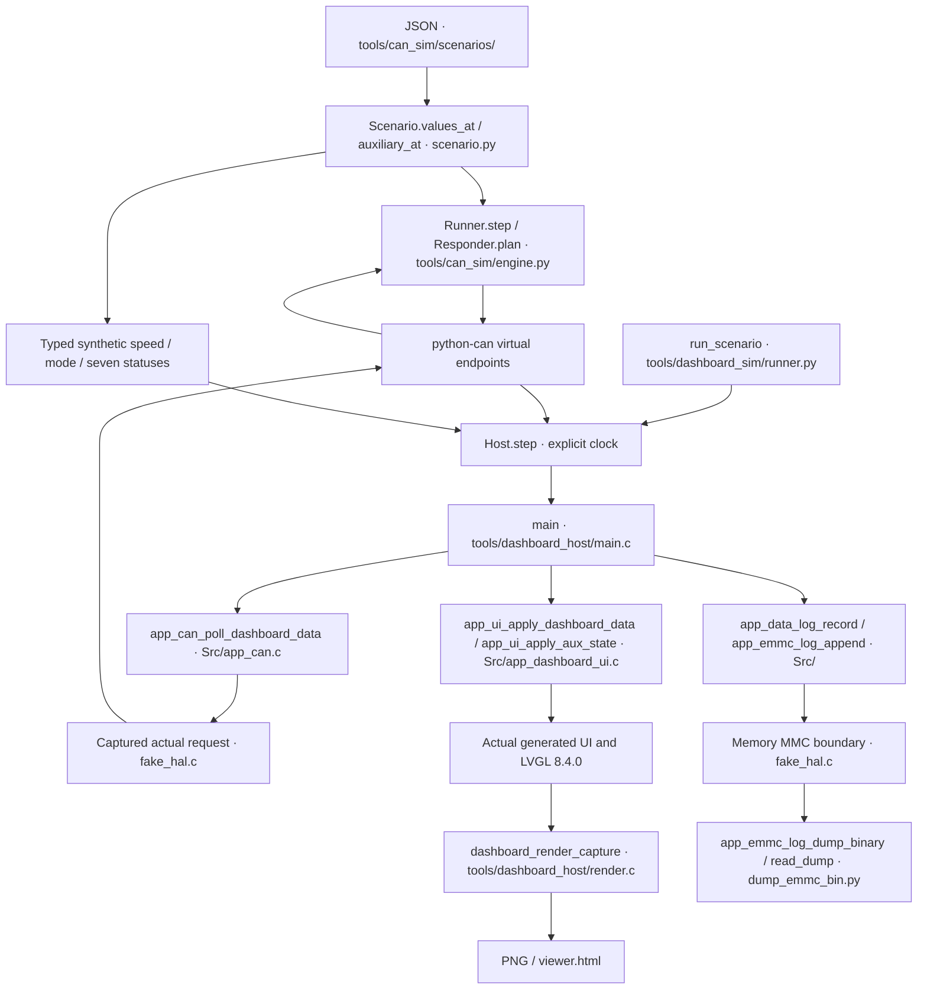
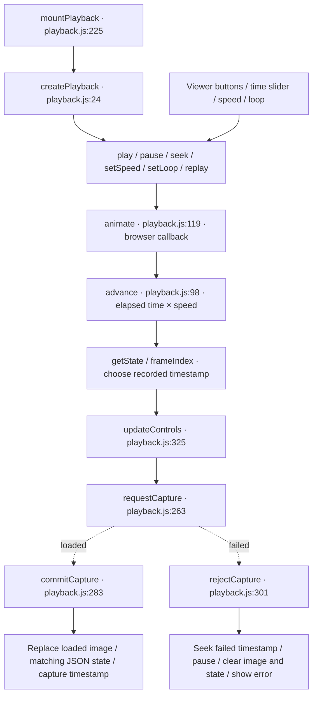

# Function flow and source locations

The diagrams describe the inspected firmware source, not a measured device trace. Solid arrows show calls or documented processing order. Dotted arrows label callbacks, task scheduling or data handoff explicitly. Full definitions, line numbers and source comments are available in [FUNCTIONS.md](FUNCTIONS.md); [function-explorer.html](function-explorer.html) provides searchable incoming/outgoing relationships. [functions.mmd](functions.mmd) is the full editable Mermaid source graph and [functions.json](functions.json) is its machine-readable inventory.

## Firmware startup and task handoff

The GUI task services LVGL every configured 5 ms; CAN polling delays 10 ms between iterations. The queue holds one latest snapshot. Screen bindings and the retained automatic speed/mode/status demo are in `Src/app_dashboard_ui.c`; the host supplies explicit auxiliary timelines through those bindings. Vehicle inputs remain unimplemented. `ui/screens/ui_Screen1.c` is retained legacy source and excluded from `ui/CMakeLists.txt`.

## CAN polling and decoding

The request timeout is strictly greater than 100 ms in the code. Tick subtraction is unsigned to support wraparound. A valid unsolicited known PID updates telemetry; only a matching pending PID advances the request sequence. This is the repository's implemented protocol; actual BMS compatibility is unverified and outside the virtual-only scope.

## Display and input callbacks

## Virtual CAN test path

```mermaid
flowchart LR
  json["Editable JSON scenario · tools/can_sim/scenarios/"] --> scenario["Scenario.from_file / values_at · scenario.py"]
  client["make_request · protocol.py"] --> bus["python-can virtual bus · in-process endpoints"]
  bus --> runner["Runner.step · engine.py · explicit simulation clock"]
  scenario --> responder["Responder.plan · engine.py"]
  runner --> responder
  responder --> encode["encode_response · protocol.py · ten source-defined PIDs"]
  encode --> faults["Timed pause/drop/delay/malformed/duplicate/burst/raw faults"]
  faults --> busout["Virtual CAN response frames"]
  busout --> received["Client receives exact frame bytes and metadata"]
  received --> replay["Test runner --replay · tests/can_host/test_app_can.c"]
  replay --> fake["In-memory HAL FIFO and controlled millisecond clock"]
  fake --> production["Production app_can_poll_dashboard_data · Src/app_can.c"]
  production --> snapshots["JSON dashboard snapshots / assertions / ASan + UBSan"]
```

This path tests frame transport and the production C decoder. The host HAL does not emulate controller registers, arbitration, bus errors, electrical behavior, LCD/touch hardware, FreeRTOS scheduling or eMMC. Linux `vcan` is an optional virtual transport; physical adapters are rejected by the new simulator. New hardware integration remains unimplemented.

## Editable host dashboard

The persistent C host is single-threaded. Screens and loggers are actual application code;
HAL/BSP and mutex boundaries are memory-only fakes. Python owns virtual transport and time.
This path does not execute FreeRTOS tasks or hardware startup.

## Recorded screen movement

The generated viewer inlines `tools/dashboard_sim/playback.js`. Its browser functions are
documented in source and included in the JavaScript/HTML inventory. Their inspected flow is:

The clock can advance between captures; the displayed state belongs to the loaded capture.
Asynchronous callbacks from older requests cannot overwrite a newer seek. Playback uses the
captured pixels and does not rerun the simulator. The default generator captures every 100 ms.
See [the playback source record](SYNTHETIC_PLAYBACK_UI_EVIDENCE.md) for API sources and regressions.

## Inventory interpretation

- The inventory covers project sources, headers, scripts and test tools. Generated font/image arrays receive file-purpose comments but contain no callable definitions.
- Dependency implementations in `Drivers/` and `lvgl/` retain their upstream documentation. Their call names remain visible as external call expressions in the explorer.
- Conditional C definitions are included without evaluating preprocessor configuration. Assembly entry labels are inventoried; the overview above shows their inspected cross-language startup calls.
- Calls resolve only when the symbol is unique or file-local. An identifier passed or assigned is a `reference`, which can indicate callback registration; execution is not inferred. Indirect or ambiguous calls remain unclassified.
- Production-source calls do not resolve to host-only HAL fakes. Host and test relationships are included separately in the same inventory; this prevents fake definitions from being presented as board implementations.
- Regenerate after source changes: `.venv/bin/python tools/generate_function_docs.py --check`.
